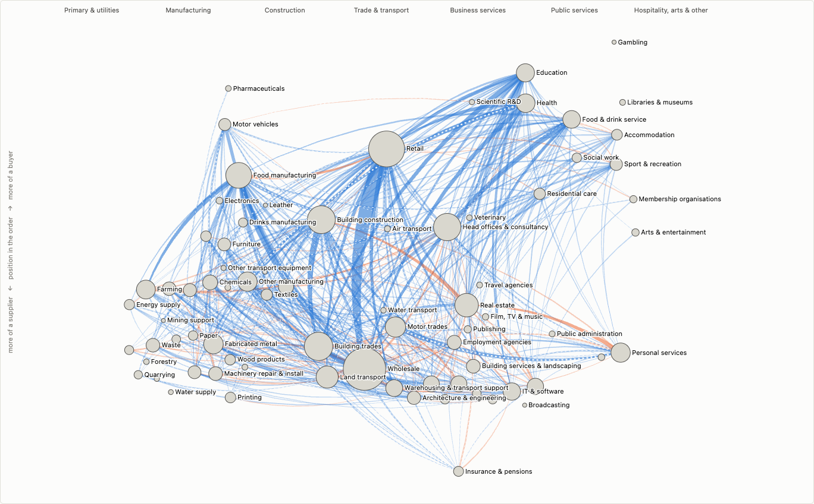
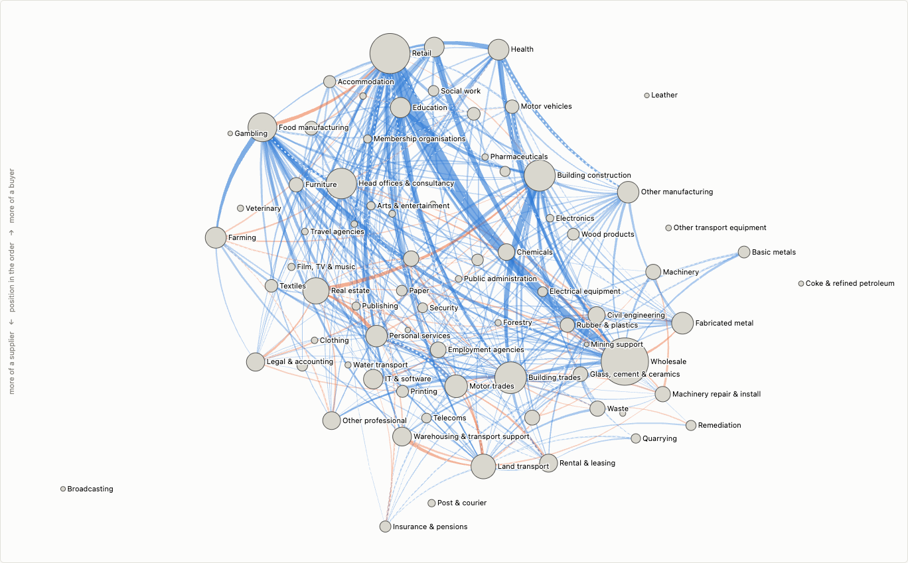
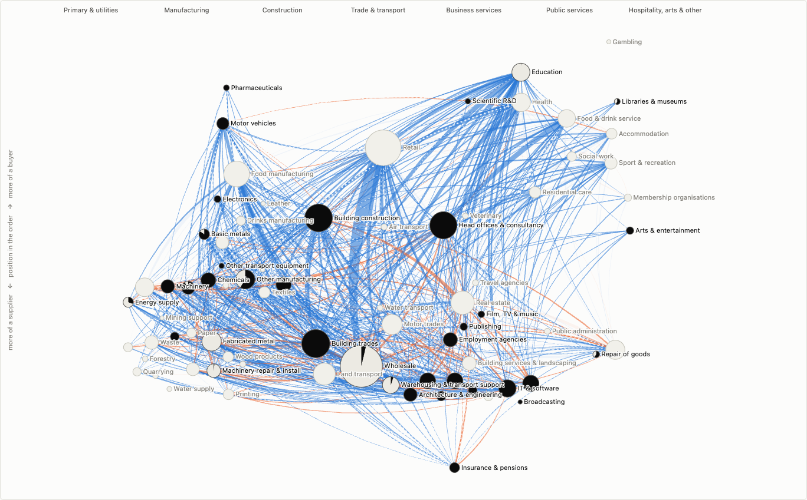
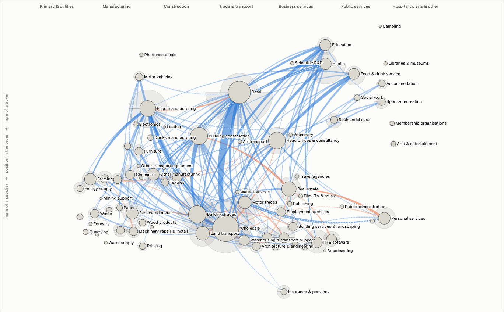
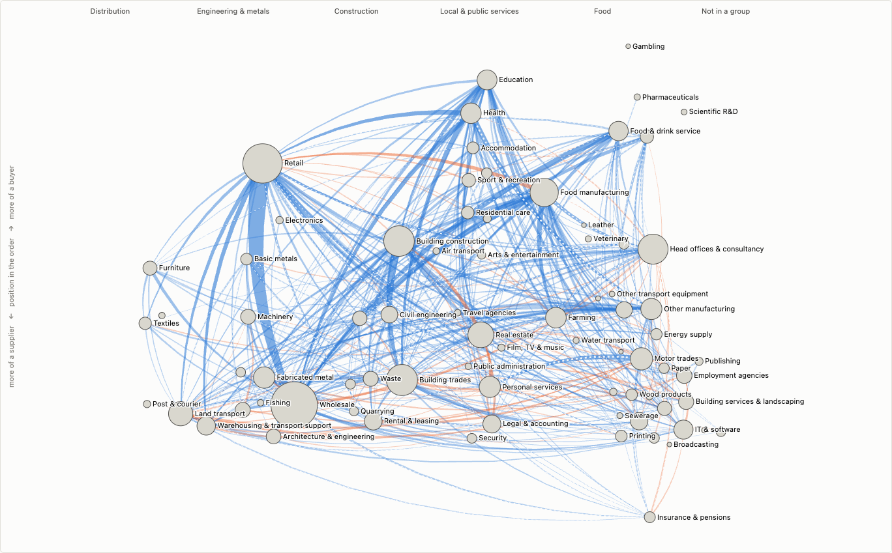
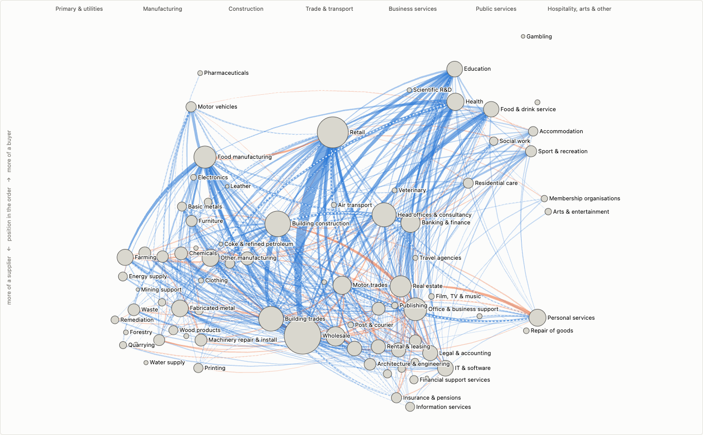

# Yorkshire and the Humber payment flows: plan for a single-page visualisation

*Written 23 November 2026 by Claude Code, and updated the same day with Dan's decisions (section 6) and three follow-up tests (sections 2.7 to 2.9). Section 10, added later that day, scopes three further changes that are not built. Builds on [`llm_output/payment_flows_handover.md`](../../../../llm_output/payment_flows_handover.md): read its sections 1 to 3 first for what the data is and what's hidden in it. Every number below comes from the scripts in [`../tests/`](../tests/README.md), run on the September and October 2026 editions.*

## 1. Summary

**What to build.** One web page showing payments between Yorkshire and the Humber's 77 industries (SIC divisions), month by month from January 2019 to September 2026, that can be stepped or played. Industries are drawn as circles and payments as links between them.

**The four questions, answered.**

1. **Is there a supplier-below-buyer structure? Yes, as a gradient, not as tiers.** The flows put industries in a stable order from suppliers to buyers. 71% of the money runs the "right" way down it (50% would be chance), the order hardly moves from month to month, and it agrees with the national input-output table about as well as could be hoped. But the order is loose: the UK's real supply chain is just as loose on the same measure, so this is how the economy is, not a data fault. Divisions are the right level. Sections blur the order, and nothing finer exists regionally.
2. **Showing the order, the industrial strategy and sections together.** Vertical position carries the order. Sector groups work best as columns. The industrial strategy and single sector groups work as a highlight that picks out one set at a time, with part-covered divisions shown as part-filled. Colour is kept for one job: which way money runs. Outside flows are three times the inside ones, so they can't be links: a headline strip plus an optional pale halo on each circle shows their scale. Five payment groups (industries that pay each other more than their sizes predict) hold up across the years and can be named and shown as columns.
3. **Files** are in `plan/` (this document) and `tests/` (code, outputs and a working prototype).
4. **Drawing approach: 2D canvas with D3. WebGL isn't needed.** Canvas drew every link with moving dots at 60 frames a second in the test. The whole dataset is 2 MB.

**Decisions** are recorded in section 6: widths start as each month's share with a switch to pounds, the four intermediary divisions get a switch, the page is public, payment groups are named, and nothing is deflated. Moving dots show how many payments a link carries (section 2.8).



*The prototype's main view. Buyers sit higher, suppliers lower. Blue links carry money down the order, orange ones against it; a link is widest at the paying end.*

## 2. What the tests found

Unless it says otherwise, figures are for payments where both sides are registered in Yorkshire and the Humber, with the four intermediary divisions (63, 64, 66, 82) and non-industries (00, 97, 98, 99) left out, as the handover advises.

### 2.1 The data over time

- **93 months,** January 2019 to September 2026, so nearly eight years.
- **About 4,500 cells a month** inside the region (payer division by payee division). 56% are hidden.
- **Hidden months are held,** using the handover's rule: at the same cell's average published month in that year, or failing that in the nearest years. Of all cell-months, 44% are published, 29% are held, and 27% belong to cells never published in any year, which stay at zero. Holding adds 11% to the inside total (£71.0bn published, £79.0bn with held values).
- **3,210 links** (ordered pairs of divisions) have some value over the period. They're very unequal: half the value is in the top 89 links, 80% in the top 430 and 90% in the top 781.
- **No break at the edition joins.** The changes from December to January at the two joins (2022: down 7%; 2025: up 1%) are inside the range of other Januaries (down 9% to up 3%).
- **The totals swell for reasons that may not be real.** Value per month rose 72% from 2019 to 2025 and the number of payments 67%, while the average payment stayed flat at about £4,100. That's the pattern the caveats note reads as more payments being captured. Played as raw pounds, the page would mostly show this.
- **Months are noisy.** Among the top 500 links the typical change from one month to the next is 18%. A three-month average brings that to 6%. February runs 8% below trend; no other month is more than 4% off.

### 2.2 Is there a supplier-to-buyer order?

**Method.** Each industry gets a level so that, as far as the data allow, a buyer sits one level above each of its suppliers, weighted by the size of the payment (trophic levels, from MacKay, Johnson and Sansom 2020). The same method gives an incoherence score: 0 means perfect tiers, with every payment dropping exactly one level, and 1 means no order at all. As a check, each pair's two directions were swapped at random 200 times, which keeps who trades with whom but scrambles which way round.

| Network | Incoherence score | Same, directions shuffled | Money running down the order |
|----|----|----|----|
| Y&H payments, by value | 0.74 | 0.90 | 71% |
| Y&H payments, by number of payments | 0.64 | 0.93 | 77% |
| UK input-output table 2019 | 0.71 | 0.91 | 74% |

- **The order is real.** Both payment scores are well below their shuffled versions (the lowest 5% of shuffles score 0.88 for value).
- **It's as strong as the real thing.** The UK input-output table scores 0.71 on the same method. The economy's own supply chain is a gradient with a lot of two-way trade, and the payments reproduce that.
- **It agrees with the input-output table.** Levels from Y&H payments by value and from the table have a rank correlation of 0.71, across 73 groups of divisions. By number of payments it's 0.40. So value should set the order.
- **It's stable.** Each year's levels correlate 0.94 to 0.98 with the whole-period levels, and each single month's correlate 0.94 at the median (lowest month 0.89). A division's level wobbles by 0.08 from month to month, against a spread of 0.35 between divisions.
- **Held values matter for stability.** On published cells only, single months drop to 0.85 at the median and 0.67 at worst.
- **The span is short:** about 1.5 levels from bottom to top by value. Draw it as a continuous scale, not as rows.
- **A simpler measure gives nearly the same order.** Levels correlate 0.96 with each division's balance of payments received against payments made. The level is still the better choice because it's the one with the input-output comparison behind it, but the balance is an easy way to explain it on the page.

**What the order looks like.** At the bottom, receiving more than they pay: insurance and pensions, security, advertising, architecture and engineering, printing, telecoms, and near them wholesale, haulage and the building trades. At the top, paying more than they receive: education, health, food and drink service, accommodation and retail. Manufacturing divisions are spread across the whole range, from printing (0.26) to motor vehicles (1.22) and pharmaceuticals (1.35).

**Three things to say on the page about reading it.**

- **The top is partly an artefact of who's missing.** Households aren't in the data, and public funding mostly arrives from outside the region. So industries that sell to households or are publicly funded show up almost only as buyers.
- **"Supplier" means "gets paid".** That includes rent, insurance premiums and business rates, not only goods and services.
- **Tiny industries sit at the extremes on thin evidence.** Gambling tops the order on £5m of payments in eight years. Mark or clamp divisions below a size threshold (section 4.3).

### 2.3 Which SIC level?

**The regional data only exist at division (two-digit) level.** The choice is divisions, something coarser, or borrowing detail from the national five-digit file.

**Coarser is worse.** Y&H, by value:

| Grouping | Groups | Incoherence score | Same, shuffled | Gap |
|----|----|----|----|----|
| Divisions | 77 | 0.74 | 0.90 | 0.15 |
| Mixed: divisions inside C, F, G, H, M and N; sections elsewhere | 59 | 0.74 | 0.90 | 0.16 |
| Sections | 19 | 0.88 | 0.96 | 0.08 |

Sections net most of the direction away (the share of each pair's flow left after netting falls from 55% to 33%). The mixed grouping gains nothing over plain divisions.

**Finer helps a little nationally, then stops, and costs stability.** The national five-digit file for 2023, rolled up:

| Level | Industries | Links | Incoherence score | Gap to shuffled | Rank correlation of levels, 2019 against 2023 |
|----|----|----|----|----|----|
| Section | 19 | 336 | 0.92 | 0.03 | 0.91 |
| Two-digit | 81 | 4,169 | 0.84 | 0.09 | 0.90 |
| Three-digit | 250 | 19,745 | 0.81 | 0.13 | 0.76 |
| Four-digit | 565 | 47,886 | 0.80 | 0.14 | 0.75 |
| Five-digit | 661 | 56,391 | 0.79 | 0.14 | 0.73 |

- **Most of the order is already there at division level:** 69% of the variation in five-digit levels lies between divisions.
- **The divisions hiding the most variety** are retail, wholesale, warehousing and transport support, education, insurance, and food and drink service.
- **The five-digit file is the weakest source.** 68% of its rows are marked `[c]` (hidden) and 18% `[-]`; only 14% carry a value. Rolled up to divisions, its order agrees least with everything else: 0.30 with Y&H's own order and 0.48 with the input-output table, where Y&H's own order scores 0.71. What `[-]` means hasn't been checked with ONS.

**Decision: divisions throughout.** A national "inside this division" panel at three digits for the six divisions above is possible later, but I'd leave it out of the first version: it's a different place, a different period (2017 to November 2024) and a much more hidden file.

### 2.4 Layouts: supplier order, connections and a hybrid

All three were built in the prototype and looked at on the real data.

- **Supplier order with sector-group columns works best as the opening view.** Vertical position is the level. Seven columns hold the sector groups (primary and utilities, manufacturing, construction, trade and transport, business services, public services, hospitality with arts and other services). You can see at once that manufacturing runs the full height while public services cluster at the top.
- **Supplier order with free columns** also works: horizontal position is then set only by who trades with whom.
- **A plain force-directed "connections" view is a ball** with wholesale, retail and construction in the middle. Three divisions account for 31% of all payments and one pair for 10%, so the big ones pull everything in. Grouping on raw payments finds only 4 loose groups (modularity 0.20).
- **Pulling by affinity fixes that.** Affinity is a pair's payments divided by what the two industries' sizes alone would predict. It finds 7 groups in a single run (modularity 0.27), most of which make sense as supply chains.
- **A single run isn't steady enough to name.** Membership agrees only moderately from year to year (0.38 to 0.76 on a 0 to 1 scale where 1 is identical) and between repeat runs on the same data (0.66). Section 2.7 takes this further and finds five groups that do hold.
- **The hybrid is the view worth having as the second option:** vertical position pulled towards the level, horizontal position by affinity. The neighbourhoods above show up left to right while buyers stay high and suppliers low.



*Hybrid: engineering and construction materials to the right, food and professional services to the left, consumer-facing industries at the top. A few barely connected divisions drift to the edges and need reining in.*

### 2.5 Sector groups, the industrial strategy, and outside flows

**Colour.** Colouring the seven sector groups fails the dataviz skill's validator when any two circles can sit side by side (the worst pair is 3.2 apart for colour-blind readers, against a floor of 6). Blue and orange for the two link directions passes easily. So colour does one job, the direction of money, and groups are shown by position and by highlighting.

**The industrial strategy list** (the sector definitions behind `Yorkshire_n_Humber_sectors_Nov2025.html`, file `RegionalEconomicTools/data/industrialstrategy2025sectordefs.csv`) fits division-level data only partly:

| | |
|----|----|
| Divisions the list touches | 40 of 88 |
| Listed as whole divisions | 29 |
| Only partly covered, by a three to five-digit code inside them | 11 |
| In more than one of the eight sectors | 14 |
| Y&H jobs in a listed code (BRES 2024) | 27% |
| Y&H jobs in a division the list touches | 45% |

- **Clean energy has no SIC codes** and can't be shown. Defence has only two part-codes, worth 210 Y&H jobs.
- **Part coverage varies enormously:** basic metals is 85% covered (steel), energy supply 31% (electricity networks), warehousing 5% (ports), wholesale 4%, education 0.2%.
- **So show the share.** `tests/lookups/indstrat_sic2.csv` gives, for each division and strategy sector, the share of the division's Y&H jobs in the listed codes. In the prototype a highlighted circle is filled like a pie to that share, and a whole division is filled completely.



*"Any industrial strategy sector" highlighted. Wholesale's thin wedge is its 4%; building trades and head offices are whole divisions on the list.*

**Outside flows.** Payments between Y&H and the rest of the UK, over the whole period with held values:

| | Value | Hidden cell-months |
|----|----|----|
| Inside Y&H | £79bn | 56% |
| Y&H pays the rest of the UK | £265bn | 77% |
| The rest of the UK pays Y&H | £230bn | 76% |

- **Outside is 3.1 times inside** for the region, and between 1.6 and 4.8 times for most divisions. The typical division keeps 27% of its spending and 26% of its income in the region.
- **London takes 23% of outside spending and gives 24% of outside income,** then the South East (19% and 14%) and the North West (14% and 15%). The handover's warning applies in full here: these are registered offices, and outside cells are more hidden, with held values adding 25 to 27%.

Three ways of showing them were tried or sketched:

| Idea | Result |
|----|----|
| **Ring gauge** round each circle, showing the outside share of income and of spending | Dropped. Nearly every industry sends around three-quarters outside, so every ring looks the same and the page just gets heavier outlines ([screenshot](../tests/outputs/screens/09a_order_groups_ring.png)). |
| **Halo:** a pale half-disc above each circle for income from outside and one below for spending outside, with areas on the same scale as the circle | Works with a thinner set of links (see below). It shows scale honestly and fits the layout, since outside buyers would sit above and outside suppliers below. With 500 links drawn it gets lost. |
| **Headline strip** above the chart: three figures and bars for the month (inside, paid out, paid in) | Not built yet. It shows the scale with no cost to the network. |

**Decision:** the headline strip always; the halo as a switch, off at first; the exact inside and outside figures for an industry in its detail panel. No outside links.



*Halos with the top 150 links. Retail's large lower half-disc is its spending outside the region. This view also shows how much clearer the page is with fewer links.*

### 2.6 Drawing: canvas, SVG or WebGL?

The prototype was played for five seconds per case in headless Chrome on an Apple M4, on a 1,400 by 1,080 window at double pixel density. Sixty frames a second is the ceiling.

| Drawing method | Links drawn | Script time per frame | Frames a second |
|----|----|----|----|
| Canvas, one fill per link | 500 | 1.7 ms | 60 |
| SVG paths | 500 | 5.2 ms | 60 |
| Canvas, one fill per link | 3,152 (every link, both directions) | 3.1 ms | 60 |
| Canvas, the same with moving dots | 3,152 | 4.3 ms | 59 |
| SVG paths | 3,157 | 23.6 ms | 35 |
| Canvas, one fill per link | about 16,000 | 17.6 ms | 18 |
| Canvas, one fill per link | about 47,000 | 41.7 ms | 6 |

- **Canvas handles everything this page needs with room to spare.** The full network is about 3,200 links and the page will usually draw a few hundred.
- **SVG is fine up to the top 500 links** and halves the frame rate with all of them.
- **WebGL isn't needed.** On these figures canvas would start dropping frames somewhere above 5,000 links, and WebGL would be worth its extra complexity from roughly 10,000. Nothing planned comes near that. The five-digit network (56,000 links) would, which is one more reason to leave it out.
- **Two traps found on the way:**
    - Merging all links of one colour into a single path looks like an optimisation and is 20 times slower (15 frames a second with every link).
    - Reading pixels back from the canvas each frame cut it to 18 frames a second. Don't do either.
- **Data size:** 77 industries, 3,210 links, 93 months, two measures, hidden-month flags and outside series come to 2.06 MB, or 0.34 MB as a web server compresses it.
- **Not tested:** a slow laptop, a phone, Firefox or Safari. The margin is large (3 ms of a 16 ms budget), but check before publishing.

**Decision:** D3 for scales, force layout and controls; a 2D canvas for drawing; ordinary HTML for controls, the tooltip, the detail panel and a table view.

### 2.7 Payment groups: which can be named?

**Method.** For each of the eight years the affinity grouping was run 2,000 times, and every pair of divisions scored on how often they landed together. Groups were then found from those scores, once per year and once for all years together. That takes out the luck of a single run. It needs that many: with 100 runs a year the result still changed with the random seed (the food group and security moved in and out of the core), and with 2,000 it came out identical on four seeds. The 11 divisions under £0.5m a month were left out of the comparisons.

**Groups that change by year don't work.** Even with the luck taken out, between 5 and 19 of the 66 divisions change group from one year to the next, and the year-on-year agreement runs from 0.46 to 0.79. A quarter of industries don't change supply chain in a year. My reading is that the boundaries are soft and small shifts in the data tip divisions across them, so a per-year view would show movement that isn't there.

**The most common grouping over all years gives five groups with a steady core.** A division counts as core if it sits with its group in at least 6 of the 8 years and lands with the group's other members in at least 60% of runs.

| Group (my names) | Core divisions |
|----|----|
| Distribution | Wholesale, retail, land transport, warehousing and transport support, furniture, textiles, post and courier, clothing, fishing |
| Engineering and metals | Fabricated metal, machinery repair and install, architecture and engineering, machinery, basic metals, electrical equipment, electronics |
| Construction | Building trades, building construction, rental and leasing, civil engineering, waste, glass, cement and ceramics, remediation, quarrying |
| Local and public services | Real estate, health, personal services, education, legal and accounting, residential care, sport and recreation, accommodation, social work, arts and entertainment, membership organisations, film, TV and music, travel agencies, air transport, libraries and museums, public administration |
| Food | Food manufacturing, farming, veterinary |

- **43 divisions are core,** and they make or receive 74% of inside payments.
- **23 float** between groups: IT and software, head offices and consultancy, motor trades, chemicals, food and drink service and insurance are the larger ones. Security sits just under the line. Printing, paper and publishing stay together but attach to a different larger group in different years, so the "media" group from the single run doesn't survive.
- **The groups aren't SIC sections under another name.** 77% of core divisions are in their section's main group; the rest cut across, such as architecture and engineering sitting with metals, and legal and accounting with local services.
- **The names are mine,** read off the members. Change them freely.

**How to show them.**

- **As columns in the supplier-order layout: works.** Each group reads as a chain from its buyers at the top to its suppliers at the bottom, with a sixth column for divisions in no group.
- **As outlines in the hybrid and connections layouts: doesn't work.** The groups aren't separate enough in space and the outlines pile on top of each other ([hybrid](../tests/outputs/screens/17_hybrid_payment_group_outlines.png), [connections](../tests/outputs/screens/18_connections_payment_group_outlines.png)).
- **As a highlight:** each group is also an entry in the highlight control.
- **Floating divisions** go in the "not in a group" column. Their detail panel says which group they most often sit with and in how many years.



*Payment groups as columns. Distribution runs from retail at the top to wholesale and haulage at the bottom.*

### 2.8 Cadence: how many payments, as well as how much

**The number of payments says something value doesn't.** Among the 430 links that carry 80% of the value, value and number of payments have a rank correlation of only 0.55. The average payment runs from £1,700 at the 10th percentile to £13,900 at the 90th, a factor of eight.

| Link (average month, latest 12 months) | Value | Payments | Average payment |
|----|----|----|----|
| Education pays building construction | £3.8m | about 120 | £33,000 |
| Education pays wholesale | £2.3m | about 1,500 | £1,600 |
| Farming pays food manufacturing | £4.2m | about 110 | £39,000 |
| Food and drink service pays retail | £2.1m | about 3,000 | £700 |

**Proposal: let the moving dots count payments.** A link's width stays the amount. Each dot travelling along it stands for 100 payments that month. A wide link with a few dots is a few large payments; a thin link crowded with dots is many small ones. Nothing else is added to the page.

- **100 is the finest unit the data support,** because ONS rounds counts to the nearest 100. A link with under 50 payments a month shows as zero and gets no dots: 48 of the top 430.
- **It fits on screen.** At one dot per 100 payments the top 430 links carry about 1,400 dots. The busiest link, food and drink service paying wholesale, has 105.
- **Dots follow the direction drawn.** With links netted per pair, the dots are the payments made in the direction shown.
- **The tooltip gives the figures:** payments that month and the average payment.
- **Still to tune:** the dots are small against the widest links in a still image ([screenshot](../tests/outputs/screens/14_dots_payments_hybrid_top150.png)). They need to be slightly larger, or lighter on wide links.

The existing switch between value and number of payments stays, for anyone who wants widths by count.

### 2.9 Switching the intermediaries in

The four are information services (63), banking and finance (64), financial support services (66), and office and business support (82).

- **The other industries barely move.** Their levels with the four in and out have a rank correlation of 0.994. The typical shift is 0.015 of a level; the largest is insurance and pensions at 0.14.
- **Two of the four are big.** Office and business support is the seventh largest division by inside payments (£40m received and £27m paid a month) and banking and finance the ninth (£18m and £27m). The other two are small. Together, 15% of inside payments involve one of them.
- **Where they sit:** information services at the very bottom, financial support services just above it, office and business support low, and banking and finance in the middle.
- **Their largest links:** banking and finance paying building construction (£8.4m a month) and health paying office and business support (£5.1m).
- **The order is slightly looser with them in** (0.77 against 0.74), and their cells are a little less hidden (51% against 56%).
- **The data file grows a little:** 81 industries and 3,627 links, 2.34 MB, or 0.38 MB compressed.

So the switch is cheap. With it on, the four appear at their own levels and the rest shift by amounts too small to notice; each state uses levels worked out on its own set of industries. The four aren't in the payment groups, which were found without them.



*Intermediaries in: banking and finance beside head offices in the middle; office and business support, financial support services and information services lower down.*

## 3. Design

### 3.1 Page, top to bottom

1. **Title and one sentence** saying what a link is.
2. **Headline strip** for the month shown: paid inside the region, paid to the rest of the UK, received from the rest of the UK, each with a bar on one scale.
3. **Controls,** one row: layout, columns, measure, how many links, highlight, and the switches in 3.3.
4. **Time bar:** play and pause, step back and forward, speed, and a slider with year marks over a small line of the monthly inside total.
5. **The chart** (canvas), with a tooltip on hover.
6. **Detail panel** for a clicked industry: its level over time, inside against outside both ways, its largest suppliers and customers that month, industrial strategy membership and how much of its data is hidden.
7. **Legend,** then a **table view** of the month's links for screen readers and copying.
8. **Notes:** what the data is and isn't (section 5), source and licence.

### 3.2 What each mark means

| Mark | Meaning |
|----|----|
| Circle | One division. Area is its payments made plus received inside the region in the period shown. |
| Vertical position | Its level in the supplier-to-buyer order, from the whole period by value, with held values. Fixed while time plays. |
| Horizontal position | By layout: sector-group column, or pulled towards the industries it trades with. |
| Link | Payments between two industries. Width is the square root of the amount. Wide at the paying end, narrow at the receiving end. |
| Link colour | Blue `#2a78d6`: money runs down the order, buyer to supplier. Orange `#eb6834`: it runs up. |
| Dots on a link | Each is 100 payments that month, moving the way the money went. |
| Dashed centre line | That month is hidden and held at an average. |
| Dark fill, or pie wedge | The industry is in the highlighted set; a wedge shows the share of its jobs that is. |
| Half-discs (halo, optional) | Above: income from the rest of the UK, in teal. Below: spending there, in green. Same area scale as the circle. In the goods and services view the two swap places, each keeping its colour. |

### 3.3 Controls and their starting values

| Control | Options | Starts at |
|----|----|----|
| Layout | Supplier order, hybrid, connections | Supplier order |
| Columns (supplier order only) | By sector group, by payment group, by how much its place shifts, free | By sector group |
| Measure | Value, number of payments | Value |
| Links | Net per pair, both directions | Net per pair |
| How many links | Enough for 50%, 80% or 90% of the month's value, or all | 80% (about 430) |
| Highlight | None, one sector group, one payment group, any or one industrial strategy sector | None |
| Flows of | Money, goods and services | Money |
| Direction | Both, down the order only, up the order only | Both |
| Rest of UK | Off, halo | Off |
| Smoothing | Single month, three-month average | Three-month average |
| Width scale | Share of the month's total, pounds | Share |
| Intermediaries | Out, in | Out |
| Hidden months | Held, published only | Held |
| Dots (one per 100 payments) | On, off | On |

### 3.4 Behaviour

- **Links point the way the money went,** from payer to payee, so they run down the page from buyers to suppliers. The data are payments and nothing else.
- **A switch shows goods and services instead.** It turns each link round (widest at the supplying end, dots moving with what was paid for) and flips the vertical order, so suppliers are at the top and things still mostly run down the page. Blue still means "down the page". This is an inference, and a wrong one for rent, insurance premiums, rates and refunds; the key and the notes say so whenever it's on.
- **Positions don't move with time.** Levels are stable enough (section 2.2) that fixing them costs little, and then everything that moves on screen is a change in payments. The detail panel shows how an industry's level drifted.
- **Changing layout** slides circles to their new places over about 0.7 seconds.
- **Switching the intermediaries in** adds four circles; the others shift slightly to the levels worked out with all 81.
- **Dots** drift along their links all the time, paused or playing, so cadence can be read on a single month.
- **Play** runs at about three months a second (the whole period in 30 seconds), blending between months, with speed options.
- **Hover** on a circle keeps its links and fades the rest, and shows the tooltip. **Click** pins it and opens the detail panel.
- **Labels** are drawn largest circle first and skipped where they would overlap; highlighted and hovered industries always get theirs.
- **Keyboard:** left and right arrows step a month, space plays and pauses.

## 4. Data pipeline

### 4.1 Steps

One R script, `build_data.R` in this chunk's folder, reusing `tests/functions_hierarchy.R`:

1. **Extract** every row touching `TLE` from the three zips (as `tests/01`). Cache in `local/`.
2. **Drop** non-industries. Keep the four intermediaries, flagged, for the switch.
3. **Hold** hidden months (as `hold_values()`), separately for inside and outside cells. Keep the basis of each cell-month: published, held, or never published.
4. **Levels:** whole-period, by value, held, worked out twice: on the 77 industries and on all 81 (as `tests/02` and `tests/11`). Also 12-month rolling levels for the detail panel.
5. **Payment groups:** the all-years grouping, with each division marked core, floating or too small (as `tests/12`). Names come from a small hand-kept table keyed on one division per group.
6. **Outside series:** for each division and month, paid to and received from the rest of the UK, with London separate so the panel can show it.
7. **Lookups:** short names, sections, sector groups, industrial strategy shares (from `tests/00`), plus each division's share of jobs in any listed code, which the prototype approximates.
8. **Write** one data file and print the checks in 4.3.

### 4.2 The data file

The same shape as the prototype's `ynh_flows.js`: one script that sets a global, so the page works from disk as well as from a server.

```
months:  ["2019-01", ...]                       93
nodes:   [{ id, short, name, section, group, role,
            level, level_all, level_rolling[93], small,        level: among the 77; level_all: among all 81
            pay_group, pay_status, pay_group_years,            pay_status: core, floating, too small, not grouped
            is8: [{ name, share, whole }], is8_any_share,
            ext_buy[93], ext_sell[93], ext_buy_london[93], ext_sell_london[93] }]
links:   { supplier[], buyer[],                 indices into nodes
           value[][93], count[][93],            GBP thousands; payments
           basis[] }                            93 characters each: p published, h held, x hidden with nothing to hold, 0 no row
```

Values are in thousands of pounds because ONS rounds to £1,000; counts are rounded to 100 at source.

### 4.3 Checks the build should print

- Totals match `tests/05`: £79.0bn inside, £265.2bn paid out, £230.2bn paid in.
- The incoherence score is 0.74 and the share running down the order 71%.
- The rank correlation with the input-output levels is still about 0.7.
- No link has a value in a month whose basis says "no row".
- The payment groups: five groups and 43 core divisions, with the same core members as section 2.7. The grouping uses random starts, so it runs 2,000 times a year; report any division that changes.
- Which divisions fall below the size threshold. I'd start at £0.5m a month of inside payments, which catches 11 of the 77: gambling, mining support, leather, broadcasting, coke and refined petroleum, water supply, sewerage, scientific R&D, forestry, water transport and other transport equipment. Draw them grey and keep them out of the vertical scale's range.

## 5. What the page must say about the data

Short, near the chart, not buried:

- **Payments, not trade.** Bacs and Faster Payments between businesses. Read a link as a sign of connection.
- **Registered offices, not activity.** A firm headquartered elsewhere pays from elsewhere. This is why the page is about flows inside the region, the more trustworthy half.
- **Households aren't in it,** so consumer-facing and publicly funded industries appear mainly as buyers.
- **Over half the monthly cells are hidden,** and hidden doesn't mean small. Held values are averages of the months that were published. Over a quarter of cell-months have nothing to hold: those links are simply absent. Retail paying food manufacturing is one.
- **Growth over time is partly coverage.** More payments are captured in later years.
- **Nominal pounds, not seasonally adjusted, experimental statistics** that are revised between editions. The page opens on each month's shares, which sidesteps price changes.
- **Payment groups are a statistical grouping,** named by hand: industries that pay each other more than their sizes predict, in most years. About two in five industries don't sit firmly in any group: 23 float and 11 are too small to place.
- **Intermediaries, when switched in,** partly show money passing through (card takings, platform payouts) and not purchases.
- **Source:** ONS, Industry-to-industry payment flows by region, UK, from Pay.UK data, under the Open Government Licence.

## 6. Decisions

Settled with Dan on 23 November 2026.

| Question | Decision |
|----|----|
| What links show | Money, payer to payee, by default. A "Flows of" switch (added 23 November, after the first build) turns every link round and the order upside down, to read the page as goods and services running down from suppliers to buyers. That view is an inference and the page says so. |
| Width scale | Opens on each month's share, with a switch to pounds. |
| Cadence | Shown, simply: moving dots, one per 100 payments (section 2.8). |
| Intermediaries | A switch in the first version, starting off. They're part of the region's economy and should be showable. |
| Publishing | A public page: `docs/chunks/paymentflowsviz_ynh/index.html`, which the repo's index script picks up and GitHub Pages serves. |
| Payment groups | Identified on the page, using the most common grouping over all years. Not per year: section 2.7 found that would mostly show noise. |
| Deflating | None. Keep to proportions. |

**Still open.**

- **The payment group names** in section 2.7 are mine. Confirm or change them.
- **The `tests/` folder goes public with the page** unless it's moved or ignored: about 20 MB of screenshots and a 3 MB prototype. I'd leave it, as a record of how the page was arrived at, but trim the screenshots.

## 7. Build steps

**Built on 23 November 2026.** All eight steps below are done except publishing, which needs the folder committed and pushed. The page is `index.html` in this chunk's folder. What differs from the plan above:

- **Payment groups have 43 core divisions, not 44.** The build runs the grouping 2,000 times a year, which made it repeatable and moved security to floating (section 2.7).
- **Columns hold their industries.** Each column's width follows what it has to hold, hairlines separate them, and a circle can't leave its column. To make that possible a circle's height is its level give or take 14 pixels, which is under half the month-to-month wobble in a level.
- **Thin links in a hidden month are drawn dashed,** since there's no room on them for a dashed centre line, and a link's tooltip says in how many of the 93 months it was published. 473 links were published in fewer than 6 months; they stay in, visibly dashed.
- **The halo is stronger and two-coloured:** 30% fill with a firm outline, teal for what's received from the rest of the UK and green for what's paid to it. The pair was chosen with the validator to be alike but separable, and clear of the blue and orange used for links.
- **A "Flows of" switch** shows goods and services (section 3.4).
- **A "Direction" switch** shows both directions, only the links running down the order (blue), or only those running up it (orange). The "links carrying 80%" cut-off is then taken within the direction chosen, so the up-only view brings out more of the orange links than the combined view does.
- **A line for the average industry** runs across the chart in the supplier-order layout, and the same line in the side panel's level chart is drawn more strongly.
- **A fourth Columns option, "By how much its place shifts",** lines industries up from the steadiest to the one whose place in the order moves most. The measure is the standard deviation of the level worked out on the 12 months to each month, the same series the side panel draws. Industries are evenly spaced in rank order, with the standard deviation marked along the top; the 11 small industries sit in a strip of their own, since their levels are mostly noise. Among the rest it runs from 0.009 (retail) to 0.160 (head offices and consultancy), with a median of 0.042, and it tracks drift more than jitter: it correlates 0.80 with the size of the change between the first and last 12 months.
- **An expandable note, "How the order is worked out, and how far to trust it",** sits under the chart and is linked from the opening paragraph. It gives the calculation, the test results from section 2.2, and the caveats.
- **A "Pin an industry" list was added,** so an industry can be found and pinned without a pointer.
- **Hovering a link** shows both directions and, when links are netted, the difference drawn.
- **D3 is kept in `lib/`,** so the page loads nothing from outside.
- **Dots redraw at half rate when nothing else is moving,** and stand still for anyone whose system asks for reduced motion.
- **Dark mode follows the system setting.** There's no switch on the page.
- **The data file is 2.7 MB,** 0.5 MB compressed, a little over the estimate, because it carries London separately and both sets of rolling levels.

**Checked** in headless Chrome (`tests/13_page_checks.cjs`): no errors; every control worked; light, dark, tablet and phone layouts looked at; 60 frames a second playing the opening view and playing every link with intermediaries in. Headline totals, one industry's breakdown and one link's value and count were compared with the source data and matched.

**Not checked:** Firefox, Safari, a real phone, a slow laptop, or a screen reader.

The steps as planned:

Each step ends with something to look at.

1. **Data.** Write `build_data.R` and the data file, with intermediaries and payment groups in it; run the checks in 4.3.
2. **Skeleton.** Page structure, canvas, and the three layouts carried over from the prototype. Rein in barely connected industries in the hybrid and connections layouts. Check against the test screenshots.
3. **Time and dots.** Slider, step, play with blending, speed, the small line of monthly totals, keyboard control, and dots that count payments. Play the whole period and watch for jumps.
4. **Headline strip and width scale.** Inside and outside figures for the month; share or pounds.
5. **Groups, highlight, hover and detail panel.** Sector-group and payment-group columns, the highlight sets, industrial strategy wedges, tooltip, pinned detail panel.
6. **Switches.** Intermediaries; halo for outside flows; published only; dashed centre lines for held months.
7. **Reading aids.** Legend with a width key, the notes in section 5, the table view.
8. **Finish.** Dark mode with its own colour steps, narrow screens, a slower machine, Firefox and Safari, then publish as decided.

The prototype (`tests/prototype/prototype.html`) already does a rough version of steps 2, 3, 5 and 6, including the intermediaries switch, payment-group columns and payment dots. Most of the remaining work is tidying, the detail panel, the headline strip and the words.

## 8. Open questions carried forward

- **Missing rows** in the regional files are treated as zero. Nobody has checked that with ONS (handover, section 7).
- **`[-]` in the five-digit file** is unexplained. It only matters if the national panel is ever built.
- **Revisions.** When ONS issues the next edition, re-run and compare the levels before updating the page.

## 9. Files

| Path | What |
|----|----|
| `index.html`, `flows.css`, `flows.js` | The page |
| `ynh_flows_data.js`, `build_data.R` | The page's data and the script that builds it |
| `lib/` | A local copy of D3 |
| `README.md` | What's in the folder and how to rebuild |
| `plan/paymentflowsviz_plan.md` | This document |
| `tests/README.md` | What each test script does and how to run it |
| `tests/00` to `12`, `functions_hierarchy.R` | The tests |
| `tests/13_page_checks.cjs` | Checks on the finished page; screenshots in `tests/outputs/page/` |
| `tests/14` to `16` | Scoping tests for section 10: all regions' data, links, and how alike regions are |
| `tests/lookups/` | Division names and sections; industrial strategy shares by division |
| `tests/outputs/` | Result tables as CSV; `screens/` holds 20 prototype screenshots |
| `tests/prototype/` | `prototype.html` and its data file `ynh_flows.js` |
| `local/paymentflowsviz_ynh/` (ignored by git) | Extracted monthly data, held values, and the scripts' printed logs |

## 10. Scoped, not built: links, all twelve regions, and how alike regions are

*Scoped on 23 November 2026. Nothing in this section has been applied to the page. The tests are `tests/14_all_regions_extract.R`, `tests/15_url_roundtrip.cjs` and `tests/16_region_similarity.R`.*

**In short.**

- **Links:** nearly done already. Every control on the page already writes itself to the address and comes back from it. What's left is small.
- **All regions:** feasible, and the data work is modest (one three-minute pass over the files, about 32 MB of data files). The real work is on the page, which was written for one region. Three regions have much thinner data than Yorkshire and the Humber.
- **Similarity:** the overall measure works and the differences between regions are real, about three times the size of a region's difference from its own earlier self. The chain-or-web measure separates the extremes but not the middle, and it lines up closely with how big a region is and how much of its data is hidden. The page should say so.

### 10.1 A link for every view

**What's there.** `tests/15` set every value of every control through the page itself, read the address, loaded that address afresh and compared.

| Control | In the address as | Values tried | Came back |
|----|----|----|----|
| Layout | `layout` = `order`, `hybrid`, `force` | 3 | 3 |
| Columns | `cols` = `group`, `paygroup`, `shift`, `free` | 4 | 4 |
| Highlight | `lens` = `group:…`, `pay:…`, `is8:…` | 22 | 22 |
| Pin an industry | `sel` = its SIC code | 78 | 78 |
| Flows of | `show` = `money`, `goods` | 2 | 2 |
| Direction | `dir` = `both`, `down`, `up` | 3 | 3 |
| Measure, Widths, Links | `measure`, `scale`, `net` | 6 | 6 |
| Show | `cover` = `0.5`, `0.8`, `0.9`, `1` | 4 | 4 |
| Speed | `speed` | 4 | 4 |
| Five tick boxes | `smooth`, `dots`, `inter`, `halo`, `pubonly` = `1` or `0` | 10 | 10 |
| Month | `m` = `2021-06` | 1 | 1 |

All 17 settings together also came back from one address of 190 characters. A mangled address falls back to the opening view without an error. `#order-note` on the end opens the note.

**What's missing.**

- **Opening the table or the note** isn't written to the address. The note opens from a link only if `#order-note` is typed in.
- **Playing** isn't in the address, so there's no link that starts the animation.
- **The address lists only settings that differ from the opening view.** If an opening setting changes later, old links silently change with it.
- **Highlight values are full names** (`pay:Local and public services`). Rename a payment group and its links break.
- **A bad month** falls back to January 2019, not the latest month. Small bug.
- **Opened from disk,** some browsers refuse to update the address. The page already ignores that, but then there's nothing to copy.
- **The region** (section 10.2) will need its own entry.

**Work.** All small.

1. A "Copy link" button that writes every setting explicitly, with a version number, so a copied link means the same thing later.
2. `table=1`, `note=1` and `play=1`.
3. Short stable codes for highlight sets, in place of names.
4. Fix the bad-month fallback.
5. A table of the settings in the folder's README.
6. Keep `tests/15` as a check, failing if any control stops coming back.

### 10.2 All twelve regions, loaded on demand

**The data.** One pass over the three ONS files (51.7 million rows) took three minutes. Each region's inside flows, between different industries, with intermediaries out and hidden months held:

| Region | Inside payments, whole period | Monthly figures hidden | In links never published | Held values add | Industries under £0.5m a month | Order's agreement with input-output table |
|----|----|----|----|----|----|----|
| North East | £11bn | 71% | 42% | 26% | 25 | 0.52 |
| North West | £96bn | 50% | 22% | 10% | 6 | 0.52 |
| Yorkshire and the Humber | £61bn | 56% | 27% | 12% | 11 | 0.71 |
| East Midlands | £42bn | 59% | 29% | 12% | 14 | 0.75 |
| West Midlands | £64bn | 56% | 28% | 17% | 10 | 0.55 |
| East of England | £69bn | 54% | 25% | 10% | 8 | 0.65 |
| London | £401bn | 52% | 25% | 8% | 4 | 0.63 |
| South East | £146bn | 48% | 21% | 12% | 4 | 0.46 |
| South West | £40bn | 55% | 27% | 12% | 6 | 0.54 |
| Wales | £12bn | 71% | 40% | 24% | 24 | 0.42 |
| Scotland | £48bn | 59% | 29% | 10% | 7 | 0.51 |
| Northern Ireland | £36bn | 68% | 38% | 11% | 17 | 0.29 |

- **Three regions are much thinner:** the North East, Wales and Northern Ireland have around 70% of monthly figures hidden and about 40% in links never published. In the North East and Wales about a fifth of the value drawn would be held averages, and a third of industries are too small to place.
- **Yorkshire and the Humber is one of the better cases.** Its order agrees with the input-output table more than any region's except the East Midlands. Northern Ireland's barely agrees (0.29).
- **Size of the job:** each region's file would be about 2.7 MB (0.5 MB compressed), so about 32 MB in the repository for all twelve, added again to its history on every rebuild. A full build would be roughly half an hour as the script stands (twelve times the Yorkshire and the Humber build), less if it reads the files once.

**What carries over unchanged.** Extraction, holding, levels, outside flows, the links and their flags, and every drawing routine.

**What doesn't.**

- **The page assumes one dataset loaded at the start.** Everything worked out from the data (series, totals, layouts, the key, the slider) needs gathering into one step that can run again when the region changes. That's the main piece of work. The data would load by adding a script for the chosen region, which still works from disk.
- **Typed-in figures.** The notes quote Yorkshire and the Humber's numbers (71%, 0.74, 0.71 and so on). For twelve regions they must be worked out by the build, carried in each data file and dropped into the text.
- **Payment groups don't travel.** Worked out region by region with the same method, the regions get 3 to 6 groups. Yorkshire and the Humber's five named groups stay separate only there. Its grouping agrees well with the North East, East Midlands and West Midlands (0.80 to 0.87 on a 0 to 1 scale) and only moderately with the rest (0.37 to 0.59). One grouping on all regions' flows added together fits no better (0.35 to 0.51 for eight of the twelve). So groups have to be worked out per region, and the hand-given names can't be reused.
- **Industrial strategy shares** need jobs by region. The five-digit jobs file by ITL3 area covers the eleven regions of Great Britain for 2023. Northern Ireland isn't in it.
- **London.** The side panel's "London" split means nothing there, and the registered-office caveat bites hardest: head offices make London's inside flows partly other regions' business.
- **"Actual amounts" aren't comparable between regions** as the page stands, because each dataset sets its own reference width. Shares are.

**Steps.**

1. `build_data.R` takes a region; a wrapper builds all twelve and a small index file listing them with the quality figures above.
2. The build writes each region's quoted figures into its file.
3. The page gathers its start-up into one re-runnable step; adds a region picker, a `region` entry in the address, and a load-on-demand script.
4. Text that names the region or quotes a figure reads from the data.
5. A visible line on data quality for each region, and a stronger warning for the three thin ones.
6. `tests/13` runs over every region.

### 10.3 Which regions are alike

Both measures use each region's inside flows over the whole period, between different industries, by value, with held values and intermediaries out.

**A. Overall similarity, sector makeup included.**

*The measure.* Write each region's flows as shares of its own total: one share for every pair of paying and paid industry. The distance between two regions is the share of one region's payments that would have to move to a different pair to match the other. 0 is identical; 1 is nothing in common.

*What it gives.*

| Region | Its two closest | Its furthest |
|----|----|----|
| North East | South West (0.38), Wales (0.39) | London (0.60) |
| North West | South West (0.33), Yorkshire and the Humber (0.34) | London (0.49) |
| Yorkshire and the Humber | North West (0.34), East of England (0.37) | London (0.56) |
| East Midlands | Yorkshire and the Humber (0.39), East of England (0.39) | London (0.62) |
| West Midlands | Yorkshire and the Humber (0.38), North West (0.39) | London (0.57) |
| East of England | South West (0.35), North West (0.36) | London (0.55) |
| London | North West (0.49), South East (0.52) | Northern Ireland (0.66) |
| South East | South West (0.41), North West (0.42) | Northern Ireland (0.60) |
| South West | North West (0.33), East of England (0.35) | London (0.54) |
| Wales | South West (0.38), North East (0.39) | London (0.63) |
| Scotland | South West (0.37), North East (0.39) | London (0.58) |
| Northern Ireland | East of England (0.41), Yorkshire and the Humber (0.44) | London (0.66) |

- **The differences are real.** Distances between regions run from 0.33 to 0.66. The same distance between a region's first half of the period and its second half runs from 0.11 to 0.17. No pair of regions is as close as a region is to its own earlier self.
- **The ranking is steady.** The 66 distances worked out on the first half and on the second half correlate 0.98.
- **Hiding doesn't drive it.** Restricting each comparison to links published in both regions gives nearly the same ranking (0.98), and a region's hidden share is only weakly related to how far it sits from the others (0.22).
- **It's mostly sector makeup.** Comparing only each industry's share of payments gives almost the same ranking (0.97). Comparing who each industry pays, with makeup taken out, also agrees (0.95): regions with similar industries also wire them up similarly.
- **London stands apart** from everything, with Northern Ireland next. The rest form a loose core around the North West, South West, East of England and Yorkshire and the Humber.
- **Even the closest pair is 0.33 apart.** With about 6,000 possible pairs of industries, a third of payments sit in different places. "Most alike" is relative.

**B. Chain or web.**

*The measure.* Two numbers, because "chain-like" means two things.

- **How one-way it is:** the share of money running down the order (section 2.2). Higher is more chain-like.
- **How spread out it is:** for the typical pound spent, the number of supplier industries its buyer's spending is in effect spread across. Lower is more chain-like. (It's the usual "effective number": 1 if a buyer pays one industry, 20 if it pays twenty equally.)

*What it gives,* most chain-like first:

| Region | Money running down the order | Supplier industries per buyer, in effect | Monthly figures hidden |
|----|----|----|----|
| Northern Ireland | 78% | 10.4 | 68% |
| North East | 75% | 16.6 | 71% |
| East of England | 73% | 16.0 | 54% |
| Wales | 73% | 15.7 | 71% |
| East Midlands | 72% | 17.5 | 59% |
| South West | 72% | 18.4 | 55% |
| Yorkshire and the Humber | 71% | 17.7 | 56% |
| Scotland | 71% | 18.5 | 59% |
| North West | 70% | 19.3 | 50% |
| West Midlands | 70% | 20.0 | 56% |
| London | 68% | 19.1 | 52% |
| South East | 67% | 21.4 | 48% |

- **The ends differ; the middle doesn't.** The spread between regions is three times a region's own year-to-year movement for the first number and six times for the second. But the seven regions from the North West to the East of England sit within 3 points of each other on the first, and neighbours in that run differ by less than one year's wobble (about 1 point). Yorkshire and the Humber is in that run. Northern Ireland at one end, and the South East and London at the other, are clearly apart.
- **It follows size and hiding.** Across the twelve regions the first number has a rank correlation of 0.70 with the share of figures hidden and of -0.80 with the region's total payments. Small regions with more hidden look more chain-like. That could be true (a smaller economy has fewer two-way links) or it could be that ONS hides the thin links that make a web. The data can't separate the two.
- **A partial check.** Using only the 1,417 links published at some point in all twelve regions, which carry 76% to 88% of each region's value, keeps the ranking (0.90 for the first number, 0.76 for the second). So it isn't only which links are hidden. Size remains tangled in.
- **One case stands out as not just size:** the East of England is large and not especially hidden, yet sits near the chain end on both numbers.

**How to show them.**

- **In the region picker:** "Most like this region: North West, East of England", from measure A.
- **A small chart of the twelve regions** on the two chain-or-web numbers, each with a bar for its own year-to-year range, so overlaps are visible. Regions whose bars overlap are described as the same.
- **A sentence that changes with the region:** for Yorkshire and the Humber, "about average: not distinguishable from six other regions". For Northern Ireland, "the most chain-like, though it is also among the most hidden".
- **A standing caveat** that chain-or-web tracks size and hiding.
- **Data:** both measures for all regions fit in one small file loaded at the start, so the picker works before any second region is fetched.

### 10.4 Decisions for you

1. **Payment groups in other regions.** I'd work them out per region and label each by its largest members, keeping hand-given names for Yorkshire and the Humber only. The alternative is to drop payment groups outside Yorkshire and the Humber.
2. **The three thin regions.** I'd include them with a prominent warning. The alternative is to leave them out.
3. **Northern Ireland's industrial strategy shares.** I'd leave the highlight off there unless you have a jobs source for it.
4. **Chain or web.** I'd show it with its caveat, as above. If the caveat makes it not worth the space, measure A alone is on firmer ground.
5. **Order of work.** I'd do 10.1 first, since 10.2 needs the region in the address anyway, then 10.2, then 10.3.
