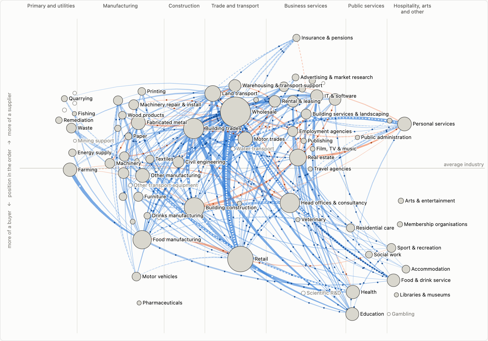
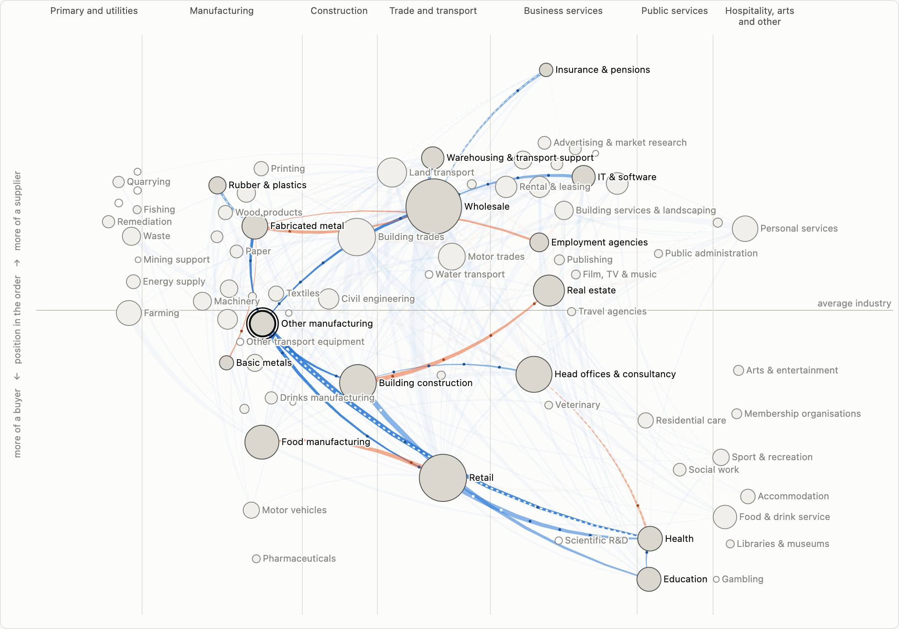
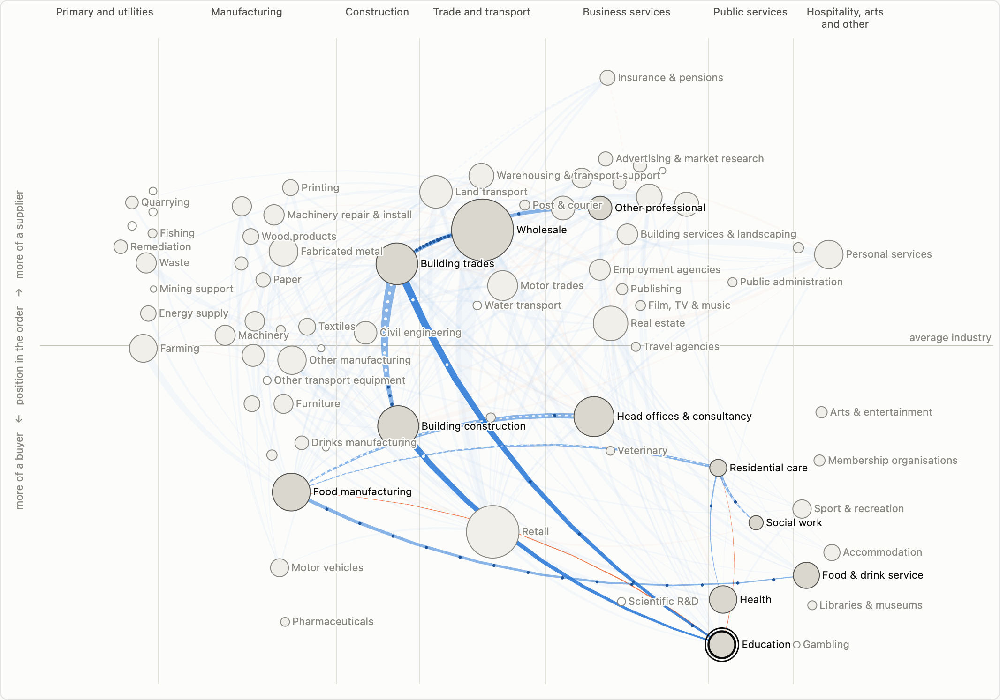
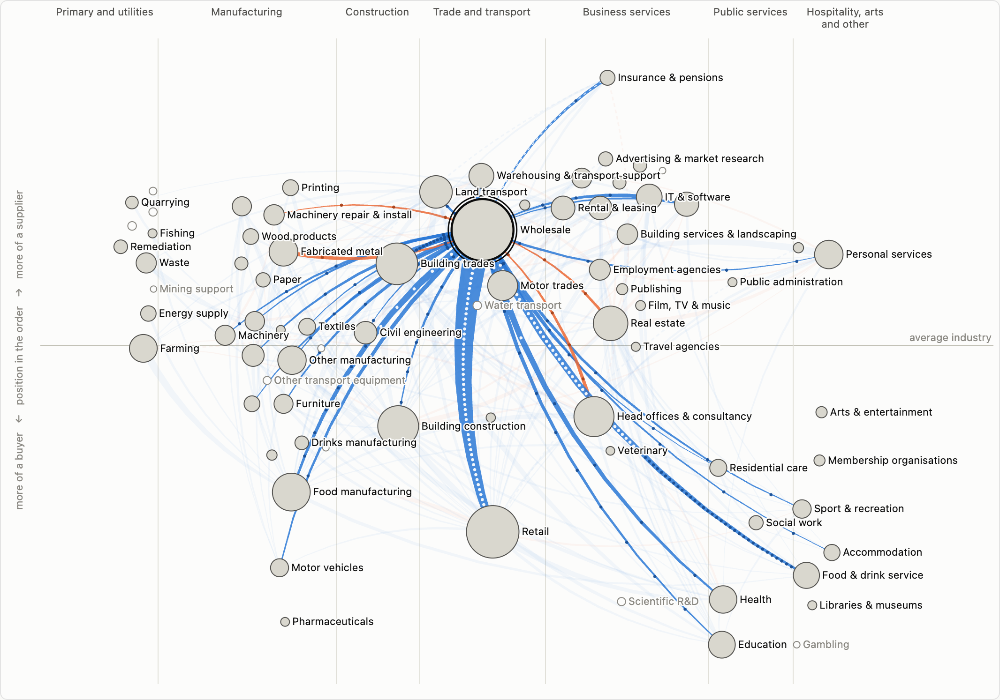

```{r}
#| label: setup
# Every figure and chart in this deck is worked out here, from the page's own data file and the test outputs in
# ../tests/outputs. Plan: ../plan/chains_deck_plan.md. Findings: sections 12 and 13 of ../plan/paymentflowsviz_plan.md.
library(data.table); library(ggplot2); library(ggrepel); library(jsonlite)
out <- '../tests/outputs'
chr <- list(character = 'sic2')
ml_all <- fread(file.path(out, 'middle_links_by_industry.csv'), colClasses = chr)      # the three-way split, every region (tests/23)
ml <- ml_all[region == 'TLE']
io <- fread(file.path(out, 'middle_links_payments_vs_io.csv'), colClasses = chr)        # the same split on the input-output table (23b)
edge_all <- fread(file.path(out, 'chains_across_the_edge.csv'), colClasses = chr)             # inside the region against UK-wide, every region (24)
edge <- edge_all[region == 'TLE']
loc <- fread(file.path(out, 'local_by_industry.csv'), colClasses = chr)[region == 'TLE']         # share bought and sold inside the region (22)
div <- fread(file.path(out, 'foundational_tradeable_divisions.csv'), colClasses = chr)  # who each industry sells to, nationally (19)
src <- fread(file.path(out, 'foundational_tradeable_receipts_by_source_ynh.csv'))       # who paid the region's industries (19)
unk <- fread(file.path(out, 'unknown_industry_by_region.csv'))[region == 'TLE']         # payers with no industry: do they have a region? (25)

# The page's data for Yorkshire and the Humber: payments between industries, month by month (GBP thousands)
txt <- paste(readLines('../data/flows_TLE.js', warn = FALSE), collapse = '\n'); key <- 'window.FLOWS_DATA.TLE = '
D <- fromJSON(sub(';\\s*$', '', substring(txt, regexpr(key, txt, fixed = TRUE) + nchar(key), nchar(txt))), simplifyVector = FALSE)
nodes <- rbindlist(lapply(D$nodes, function(n) data.table(id = n$id, short = n$short, role = n$role)))
lk <- data.table(supplier = unlist(D$links$supplier) + 1L, buyer = unlist(D$links$buyer) + 1L,
                 v = vapply(D$links$value, function(v) sum(unlist(v)), 0) / 1e3 / length(D$months))      # GBP millions a month
partners <- function(sic) {                    # what an industry sells to and buys from each other industry in the region
  i <- which(nodes$id == sic); core <- nodes$role == 'industry'
  p <- merge(lk[supplier == i & core[buyer], .(j = buyer, sells = v)], lk[buyer == i & core[supplier], .(j = supplier, buys = v)], by = 'j', all = TRUE)
  p[is.na(sells), sells := 0][is.na(buys), buys := 0][, short := nodes$short[j]][]
}
# One net link a pair, as the page's chain trace uses (chains() and traceOf() in flows.js): the two directions between a
# pair are netted off and what is left runs one way. Goods run from -> to, and 'to' pays 'from'. GBP millions a month.
core <- nodes$role == 'industry'
nl <- lk[core[supplier] & core[buyer] & supplier != buyer][, `:=`(a = pmin(supplier, buyer), b = pmax(supplier, buyer))][
  , .(v = sum(ifelse(supplier == a, v, -v))), by = .(a, b)][v != 0, .(from = ifelse(v > 0, a, b), to = ifelse(v > 0, b, a), v = abs(v))]
trace_share <- 0.1                             # the page's cut-off: a link is kept at a tenth or more (TRACE_SHARE in flows.js)
one_way <- function(sic, buying) {             # an industry's one-way buying (or selling) by partner, largest first, with each partner's share
  i <- which(nodes$id == sic); d <- if (buying) nl[to == i, .(j = from, v)] else nl[from == i, .(j = to, v)]
  d[, share := v / sum(v)][order(-v)][, `:=`(short = nodes$short[j], id = nodes$id[j], kept = share >= trace_share)][]
}
om_buy <- one_way('32', TRUE); om_sell <- one_way('32', FALSE)
count_word <- function(n) c('One', 'Two', 'Three', 'Four', 'Five', 'Six')[n]

pc <- function(x) paste0(round(100 * x), '%')
gbp <- function(x) paste0('£', ifelse(x >= 10, round(x), formatC(x, format = 'f', digits = 1)), 'm')
one <- function(d, sic) d[sic2 == sic]
om <- one(edge, '32'); ed <- one(edge, '85'); wh <- one(edge, '46')                   # inside the region and UK-wide
om_m <- one(ml, '32'); ed_m <- one(ml, '85'); wh_m <- one(ml, '46')                   # pounds a month, and which way payments run
om_io <- one(io, '32'); ed_io <- one(io, '85'); wh_io <- one(io, '46'); wh_loc <- one(loc, '46')
om_d <- one(div, '32'); ed_d <- one(div, '85'); wh_d <- one(div, '46')
both <- merge(ml[, .(sic2, industry, here = passed_along)], io[, .(sic2, national = io_passed_along)], by = 'sic2')
rho_here <- cor(both$here, both$national, method = 'spearman'); rho_pooled <- cor(io$pay_passed_along, io$io_passed_along, method = 'spearman')

# ---- how the charts look. Three colours, used for one thing only (checked with the dataviz validator); the rest is grey and ink.
ink <- '#0b0b0b'; ink2 <- '#52514e'; muted <- '#898781'; pale <- '#c3c2b7'; grid <- '#e1e0d9'; surface <- '#fcfcfb'
parts <- c('Passed along' = '#2a78d6', 'Two-way' = '#eb6834', 'End of the line' = '#1baf7a')
theme_set(theme_minimal(base_size = 13) + theme(
  text = element_text(colour = ink2), axis.text = element_text(colour = ink2, size = 12), axis.title = element_text(colour = ink2, size = 11.5),
  panel.grid.minor = element_blank(), panel.grid.major.y = element_blank(), panel.grid.major.x = element_line(colour = grid, linewidth = 0.35),
  plot.background = element_rect(fill = surface, colour = NA), panel.background = element_rect(fill = surface, colour = NA),
  legend.position = 'top', legend.justification = 'left', legend.title = element_blank(), legend.text = element_text(colour = ink, size = 12),
  legend.key.size = unit(11, 'pt'), legend.margin = margin(0, 0, 0, 0), legend.box.margin = margin(0, 0, -4, 0),
  strip.text = element_text(colour = ink, size = 13, face = 'bold', hjust = 0), plot.margin = margin(4, 8, 4, 4)))

# Stacked bars of the three-way split. d: label, passed, two_way, end, kind. Passed along is first, so it starts from the same edge in every bar.
bars3 <- function(d) {
  d <- copy(d)[, label := factor(label, levels = rev(label))]
  long <- melt(d, id.vars = c('label', 'kind'), measure.vars = c('passed', 'two_way', 'end'), variable.name = 'part', value.name = 'share')
  long[, part := factor(c(passed = 'Passed along', two_way = 'Two-way', end = 'End of the line')[as.character(part)], levels = names(parts))]
  ggplot(long, aes(share, label, fill = part)) +
    geom_col(width = 0.4, colour = surface, linewidth = 1.1, position = position_stack(reverse = TRUE)) +
    geom_text(aes(label = ifelse(share >= 0.06, pc(share), '')), position = position_stack(vjust = 0.5, reverse = TRUE), colour = ink, size = 4.1) +
    geom_text(data = d, aes(x = 1.015, y = label, label = kind), inherit.aes = FALSE, hjust = 0, colour = ink2, size = 4.1) +
    scale_fill_manual(values = parts) + scale_x_continuous(labels = pc, breaks = seq(0, 1, 0.25), limits = c(0, 1.2), expand = c(0, 0)) +
    labs(x = NULL, y = NULL) + theme(axis.text.y = element_text(colour = ink, size = 13))
}
# What an industry buys from (left) and sells to (right) its largest partners here; suppliers at the top, as on the page's goods view
partner_chart <- function(sic, n = 8) {
  p <- partners(sic)[order(-(sells + buys))][1:n][, net := sells - buys]; p[, short := factor(short, levels = short[order(-net)])]
  top <- max(p$sells, p$buys)
  ggplot(p, aes(y = short)) + geom_col(aes(x = -buys), fill = ink2, width = 0.42) + geom_col(aes(x = sells), fill = ink2, width = 0.42) +
    geom_vline(xintercept = 0, colour = ink, linewidth = 0.5) +
    geom_text(aes(x = -buys, label = ifelse(buys >= 0.05, gbp(buys), '')), hjust = 1.18, colour = ink, size = 3.9) +
    geom_text(aes(x = sells, label = ifelse(sells >= 0.05, gbp(sells), '')), hjust = -0.18, colour = ink, size = 3.9) +
    annotate('text', x = -top * 0.04, y = n + 0.9, label = '← it buys from them', hjust = 1, colour = ink2, size = 4.1) +
    annotate('text', x = top * 0.04, y = n + 0.9, label = 'it sells to them →', hjust = 0, colour = ink2, size = 4.1) +
    scale_x_continuous(limits = c(-top * 1.25, top * 1.25), labels = function(v) abs(v)) + scale_y_discrete(expand = expansion(add = c(0.6, 1.3))) +
    labs(x = '£ million a month, other industries in the region, whole period', y = NULL) + theme(axis.text.y = element_text(colour = ink, size = 13))
}
# Step one of the chain trace for one industry: each partner's share of its one-way buying and of its one-way selling,
# against the page's cut-off. Links kept are dark, links left out pale. A share that rounds to the cut-off but misses it is given in full.
trace_step_chart <- function(sic, n = 7) {
  b <- one_way(sic, TRUE); s <- one_way(sic, FALSE); kinds <- c('A tenth or more: kept in the chain', 'Under a tenth: left out')
  panels <- c(paste0('One-way buying, ', gbp(sum(b$v)), ' a month'), paste0('One-way selling, ', gbp(sum(s$v)), ' a month'))
  d <- rbind(b[1:min(n, .N)][, side := 1L], s[1:min(n, .N)][, side := 2L])
  d[, `:=`(panel = factor(panels[side], levels = panels), key = paste(side, short, sep = '|'), what = factor(kinds[2 - kept], levels = kinds))]
  d[, key := factor(key, levels = rev(key))]
  d[, lab := ifelse(!kept & round(100 * share) == 100 * trace_share, sprintf('%.2f%%', 100 * share), pc(share))]
  ggplot(d, aes(share, key, fill = what)) + geom_col(width = 0.5) +
    geom_vline(xintercept = trace_share, colour = ink, linewidth = 0.5, linetype = '22') +
    geom_label(aes(label = lab, colour = what), hjust = 0, nudge_x = 0.004, size = 4.1, fill = surface, border.colour = NA, label.padding = unit(2, 'pt'), show.legend = FALSE) +
    facet_wrap(~panel, scales = 'free_y') +
    scale_fill_manual(values = setNames(c(ink2, pale), kinds), drop = FALSE) + scale_colour_manual(values = setNames(c(ink, ink2), kinds), drop = FALSE) +
    scale_x_continuous(labels = pc, breaks = function(l) { b <- seq(0, 1, 0.1); b[b <= l[2] - 0.03] }, limits = c(0, max(d$share) * 1.2), expand = c(0, 0)) +
    scale_y_discrete(labels = function(x) sub('^[^|]*\\|', '', x)) +
    labs(x = 'Share of its one-way buying or selling with other industries in the region, whole period', y = NULL) +
    theme(axis.text.y = element_text(colour = ink, size = 13), panel.spacing.x = unit(26, 'pt'))
}
```

## The chain in our heads

A supply chain passes goods and services from one business to the next. Each adds something, and it ends with someone who uses the result.

```{=html}
<svg class="diagram" viewBox="0 0 1160 190" role="img" aria-label="A chain of five boxes: materials, maker, wholesaler, shop, household, each passing goods to the next">
  <defs><marker id="ah-ink" markerWidth="10" markerHeight="10" refX="8" refY="5" orient="auto"><path d="M0,0L10,5L0,10Z" fill="#52514e"/></marker></defs>
  <g font-size="22" text-anchor="middle" fill="#0b0b0b">
    <rect x="1" y="40" width="180" height="76" rx="10" fill="#f0efea" stroke="#52514e"/><text x="91" y="86">Materials</text>
    <rect x="246" y="40" width="180" height="76" rx="10" fill="#f0efea" stroke="#52514e"/><text x="336" y="86">Maker</text>
    <rect x="491" y="40" width="180" height="76" rx="10" fill="#f0efea" stroke="#52514e"/><text x="581" y="86">Wholesaler</text>
    <rect x="736" y="40" width="180" height="76" rx="10" fill="#f0efea" stroke="#52514e"/><text x="826" y="86">Shop</text>
    <rect x="979" y="40" width="180" height="76" rx="10" fill="#fcfcfb" stroke="#52514e" stroke-dasharray="6 5"/><text x="1069" y="86">Household</text>
  </g>
  <g stroke="#52514e" stroke-width="2.5" marker-end="url(#ah-ink)"><line x1="186" y1="78" x2="240" y2="78"/><line x1="431" y1="78" x2="485" y2="78"/><line x1="676" y1="78" x2="730" y2="78"/><line x1="921" y1="78" x2="973" y2="78"/></g>
  <g font-size="18" fill="#52514e" text-anchor="middle"><text x="336" y="150">turns them into goods</text><text x="581" y="150">gathers and sells on</text><text x="826" y="150">sells to the public</text><text x="1069" y="150">uses them</text></g>
</svg>
```

- **A middle link** buys from one kind of business and sells on to another.
- **An end** is where the chain starts, or where what was made is finally used.

This deck asks how much of that we can see in payments between industries.

## What the data is

Payments between businesses, by industry and region, each month. Turn a payment round and it stands for goods or a service going the other way.

```{=html}
<svg class="diagram" viewBox="0 0 1160 210" role="img" aria-label="A shop pays a wholesaler; goods are assumed to travel from the wholesaler to the shop">
  <defs><marker id="ah-ink2" markerWidth="10" markerHeight="10" refX="8" refY="5" orient="auto"><path d="M0,0L10,5L0,10Z" fill="#0b0b0b"/></marker>
        <marker id="ah-grey" markerWidth="10" markerHeight="10" refX="8" refY="5" orient="auto"><path d="M0,0L10,5L0,10Z" fill="#898781"/></marker></defs>
  <g font-size="22" text-anchor="middle" fill="#0b0b0b">
    <rect x="170" y="62" width="200" height="86" rx="10" fill="#f0efea" stroke="#52514e"/><text x="270" y="113">Shop</text>
    <rect x="790" y="62" width="200" height="86" rx="10" fill="#f0efea" stroke="#52514e"/><text x="890" y="113">Wholesaler</text>
  </g>
  <line x1="378" y1="86" x2="782" y2="86" stroke="#0b0b0b" stroke-width="2.5" marker-end="url(#ah-ink2)"/>
  <line x1="782" y1="126" x2="378" y2="126" stroke="#898781" stroke-width="2.5" stroke-dasharray="7 6" marker-end="url(#ah-grey)"/>
  <g font-size="19" text-anchor="middle"><text x="580" y="70" fill="#0b0b0b">pays £100: this is what the data records</text><text x="580" y="158" fill="#52514e">goods worth £100: this is what we infer</text></g>
</svg>
```

- The page can draw either. This deck uses **goods and services**, because that is what a chain is made of.
- **Services count as much as goods.** Rent is the use of a building and insurance is cover. Both go into production, even though nothing travels down a road.
- **It is still an inference.** The data records that a payment was made, not what for. Some aren't purchases at all: taxes, subsidies, dividends. ONS says it can't yet tell the types apart.

## What the data leaves out

Of each £1 that industries in Yorkshire and the Humber were paid, only about 10p came from another industry in the region. That 10p is the network the page draws.

```{r}
#| fig-width: 11
#| fig-height: 2.5
s <- src[pct >= 1][, label := c('payer of unknown industry' = 'Payers whose industry isn\'t recorded', 'industries in other regions' = 'Industries in other regions',
  'industries in the region' = 'Industries in the region', 'intermediaries' = 'Intermediaries (finance, business support)',
  'public administration, no region' = 'Public administration (no region given)')[source]]
s[, label := factor(label, levels = label[order(pct)])][, here := source == 'industries in the region']
ggplot(s, aes(pct, label, fill = here)) + geom_col(width = 0.42) + geom_text(aes(label = paste0(round(pct), 'p')), hjust = -0.25, colour = ink, size = 4.3) +
  scale_fill_manual(values = c(`TRUE` = ink, `FALSE` = pale), guide = 'none') + scale_x_continuous(limits = c(0, 56), expand = c(0, 0), labels = function(v) paste0(v, 'p')) +
  labs(x = NULL, y = NULL) + theme(axis.text.y = element_text(colour = ink, size = 13))
```

- **Not in the data at all:** households, and anything bought from or sold abroad.
- **In the data but not placed:** payers whose industry isn't recorded, and public administration, which has no region.
- **Why so many have no industry:** ONS finds an account's industry and its address by matching its name to Companies House, or to lists of public bodies. No match means neither: of what such payers send to the region, `r pc(unk$unknown_payers_no_region)` comes from payers with no region either.

## The page {.shot}

:::: {.columns}
::: {.column width="64%"}
{fig-alt="The payment flows chart for Yorkshire and the Humber in the goods view"}
:::
::: {.column width="36%"}
Each circle is an industry. Each link is goods or services passing between two of them.

- **Suppliers sit higher, buyers lower.**
- **Wholesale** is the largest circle, in the upper half.
- **Other manufacturing** sits on the line marking the average industry.
- **Education** is at the very bottom.

[Open this view](../index.html?show=goods){target="_blank"}
:::
::::

## A test for "in a chain"

Take everything an industry buys from and sells to the other industries in its region. Each pound of it is one of three things.

```{=html}
<svg class="diagram" viewBox="0 0 1160 266" role="img" aria-label="Three small diagrams: passed along, two-way, and end of the line">
  <defs>
    <marker id="ah-b" markerWidth="10" markerHeight="10" refX="8" refY="5" orient="auto"><path d="M0,0L10,5L0,10Z" fill="#2a78d6"/></marker>
    <marker id="ah-o" markerWidth="10" markerHeight="10" refX="8" refY="5" orient="auto"><path d="M0,0L10,5L0,10Z" fill="#eb6834"/></marker>
    <marker id="ah-g" markerWidth="10" markerHeight="10" refX="8" refY="5" orient="auto"><path d="M0,0L10,5L0,10Z" fill="#1baf7a"/></marker>
  </defs>
  <g font-size="24" font-weight="650" fill="#0b0b0b">
    <rect x="0" y="6" width="16" height="16" rx="3" fill="#2a78d6"/><text x="26" y="22">Passed along</text>
    <rect x="400" y="6" width="16" height="16" rx="3" fill="#eb6834"/><text x="426" y="22">Two-way</text>
    <rect x="800" y="6" width="16" height="16" rx="3" fill="#1baf7a"/><text x="826" y="22">End of the line</text>
  </g>
  <g font-size="18" text-anchor="middle" fill="#0b0b0b">
    <rect x="0" y="60" width="92" height="56" rx="8" fill="#fcfcfb" stroke="#898781"/><text x="46" y="95">A</text>
    <rect x="134" y="60" width="92" height="56" rx="8" fill="#d9d7ce" stroke="#52514e"/><text x="180" y="95">Industry</text>
    <rect x="268" y="60" width="92" height="56" rx="8" fill="#fcfcfb" stroke="#898781"/><text x="314" y="95">B</text>
    <rect x="400" y="60" width="92" height="56" rx="8" fill="#fcfcfb" stroke="#898781"/><text x="446" y="95">A</text>
    <rect x="574" y="60" width="92" height="56" rx="8" fill="#d9d7ce" stroke="#52514e"/><text x="620" y="95">Industry</text>
    <rect x="800" y="60" width="92" height="56" rx="8" fill="#fcfcfb" stroke="#c3c2b7" stroke-dasharray="5 5"/><text x="846" y="95" fill="#898781">?</text>
    <rect x="934" y="60" width="92" height="56" rx="8" fill="#d9d7ce" stroke="#52514e"/><text x="980" y="95">Industry</text>
    <rect x="1068" y="60" width="92" height="56" rx="8" fill="#fcfcfb" stroke="#898781"/><text x="1114" y="95">B</text>
  </g>
  <g stroke-width="3">
    <line x1="96" y1="88" x2="129" y2="88" stroke="#2a78d6" marker-end="url(#ah-b)"/><line x1="230" y1="88" x2="263" y2="88" stroke="#2a78d6" marker-end="url(#ah-b)"/>
    <line x1="497" y1="78" x2="568" y2="78" stroke="#eb6834" marker-end="url(#ah-o)"/><line x1="569" y1="100" x2="498" y2="100" stroke="#eb6834" marker-end="url(#ah-o)"/>
    <line x1="1030" y1="88" x2="1063" y2="88" stroke="#1baf7a" marker-end="url(#ah-g)"/>
  </g>
  <g font-size="19" fill="#52514e">
    <text x="0" y="160">Bought from one industry</text><text x="0" y="186">and sold on to another.</text><text x="0" y="226" fill="#0b0b0b">This is a chain.</text>
    <text x="400" y="160">Bought from an industry that</text><text x="400" y="186">buys the same amount back.</text><text x="400" y="226" fill="#0b0b0b">It nets off: no direction.</text>
    <text x="800" y="160">Sold here, but not bought here:</text><text x="800" y="186">a supplier end. Or the reverse:</text><text x="800" y="212">a buyer end.</text><text x="800" y="252" fill="#0b0b0b">The chain starts or stops.</text>
  </g>
</svg>
```

**No cut-off separates them. Trade is matched up, one partner at a time.** Buy £10 from an industry and sell it £4: £4 each way is two-way, and the £6 left over runs one way. That one-way buying is set against one-way selling to *other* industries. What matches is passed along. The rest is an end of the line.

The three always add up to the whole. Nothing here depends on where the page puts the industry.

## The three industries, tested

```{r}
#| fig-width: 11
#| fig-height: 2.7
bars3(rbind(om, ed, wh)[, .(label = short, passed = inside_passed, two_way = inside_two_way, end = inside_end, kind = paste(inside_kind, 'end'))])
```

- **Other manufacturing** passes along nearly half of its trade with other industries here. A middle link.
- **Education** passes along almost nothing. It buys here, and those it provides for mostly aren't in the data.
- **Wholesale** passes along `r pc(wh$inside_passed)`. On this test it is where goods *start*.

::: {.source}
Trade with other industries inside Yorkshire and the Humber, by what was paid, January 2019 to September 2026. Test 23.
:::

## Drawing a chain, one pair at a time

The test gives a figure. To show *which* industries, the page traces a chain from the one that is pinned.

```{=html}
<svg class="diagram" viewBox="0 0 1160 248" role="img" aria-label="A pinned industry in the middle. To its left, three suppliers providing 40%, 15% and 6% of its one-way buying: the first two are kept and the third is left out. To its right, three customers taking 55%, 20% and 8% of its one-way selling: the third is left out. The same is done once more from each industry kept">
  <defs>
    <marker id="ah-k" viewBox="0 0 10 10" markerWidth="5.5" markerHeight="5.5" refX="8" refY="5" orient="auto"><path d="M0,0L10,5L0,10Z" fill="#0b0b0b"/></marker>
    <marker id="ah-m" viewBox="0 0 10 10" markerWidth="5.5" markerHeight="5.5" refX="8" refY="5" orient="auto"><path d="M0,0L10,5L0,10Z" fill="#898781"/></marker>
    <marker id="ah-p" viewBox="0 0 10 10" markerWidth="5.5" markerHeight="5.5" refX="8" refY="5" orient="auto"><path d="M0,0L10,5L0,10Z" fill="#c3c2b7"/></marker>
  </defs>
  <g font-size="17" fill="#52514e">
    <text x="0" y="18">Step two: their suppliers</text>
    <text x="327" y="18" text-anchor="middle">Step one: its suppliers</text>
    <text x="833" y="18" text-anchor="middle">Step one: its customers</text>
    <text x="1160" y="18" text-anchor="end">Step two: their customers</text>
  </g>
  <g font-size="18" text-anchor="middle" fill="#0b0b0b">
    <rect x="505" y="122" width="150" height="56" rx="8" fill="#d9d7ce" stroke="#52514e"/><text x="580" y="156" font-weight="650">Pinned industry</text>
    <rect x="252" y="60" width="150" height="40" rx="8" fill="#fcfcfb" stroke="#52514e"/><text x="327" y="86">40%</text>
    <rect x="252" y="130" width="150" height="40" rx="8" fill="#fcfcfb" stroke="#52514e"/><text x="327" y="156">15%</text>
    <rect x="252" y="200" width="150" height="40" rx="8" fill="#fcfcfb" stroke="#c3c2b7" stroke-dasharray="5 5"/><text x="327" y="226" fill="#898781">6%: left out</text>
    <rect x="758" y="60" width="150" height="40" rx="8" fill="#fcfcfb" stroke="#52514e"/><text x="833" y="86">55%</text>
    <rect x="758" y="130" width="150" height="40" rx="8" fill="#fcfcfb" stroke="#52514e"/><text x="833" y="156">20%</text>
    <rect x="758" y="200" width="150" height="40" rx="8" fill="#fcfcfb" stroke="#c3c2b7" stroke-dasharray="5 5"/><text x="833" y="226" fill="#898781">8%: left out</text>
    <rect x="0" y="38" width="150" height="36" rx="8" fill="#fcfcfb" stroke="#898781"/><text x="75" y="62">30%</text>
    <rect x="0" y="86" width="150" height="36" rx="8" fill="#fcfcfb" stroke="#898781"/><text x="75" y="110">12%</text>
    <rect x="0" y="134" width="150" height="36" rx="8" fill="#fcfcfb" stroke="#898781"/><text x="75" y="158">25%</text>
    <rect x="1010" y="38" width="150" height="36" rx="8" fill="#fcfcfb" stroke="#898781"/><text x="1085" y="62">35%</text>
    <rect x="1010" y="86" width="150" height="36" rx="8" fill="#fcfcfb" stroke="#898781"/><text x="1085" y="110">18%</text>
    <rect x="1010" y="134" width="150" height="36" rx="8" fill="#fcfcfb" stroke="#898781"/><text x="1085" y="158">60%</text>
  </g>
  <g stroke-width="3" stroke="#0b0b0b">
    <line x1="407" y1="82" x2="499" y2="138" marker-end="url(#ah-k)"/><line x1="407" y1="150" x2="499" y2="150" marker-end="url(#ah-k)"/>
    <line x1="660" y1="138" x2="752" y2="82" marker-end="url(#ah-k)"/><line x1="660" y1="150" x2="752" y2="150" marker-end="url(#ah-k)"/>
  </g>
  <g stroke-width="2.5" stroke="#898781">
    <line x1="155" y1="57" x2="246" y2="74" marker-end="url(#ah-m)"/><line x1="155" y1="103" x2="246" y2="86" marker-end="url(#ah-m)"/><line x1="155" y1="151" x2="246" y2="150" marker-end="url(#ah-m)"/>
    <line x1="913" y1="74" x2="1004" y2="57" marker-end="url(#ah-m)"/><line x1="913" y1="86" x2="1004" y2="103" marker-end="url(#ah-m)"/><line x1="913" y1="150" x2="1004" y2="151" marker-end="url(#ah-m)"/>
  </g>
  <g stroke-width="2" stroke="#c3c2b7" stroke-dasharray="5 5">
    <line x1="407" y1="218" x2="499" y2="164" marker-end="url(#ah-p)"/><line x1="660" y1="164" x2="752" y2="218" marker-end="url(#ah-p)"/>
  </g>
</svg>
```

::: {.steps}
1. **One link a pair.** Two-way trade is netted off first, as in the test. What is left between two industries runs one way.
2. **Keep the large links.** A supplier stays if it provides a tenth or more of the industry's one-way buying. A customer stays if it takes a tenth or more of its one-way selling.
3. **Once more, then stop.** The same rule is applied from each industry reached. Two steps each way.
:::

## The test and the trace

Two tools, and they answer different questions.

|   | The test | The trace |
|---|-------|-------|
| **It answers** | How much does this industry pass along? | Which industries is it linked to? |
| **It works on** | The industry's totals | One pair of industries at a time |
| **Its cut-off** | None: trade is matched up | A tenth of one-way buying or selling |

- **Pairs are all the data has.** No payment is tied to any other payment, so every chain of three is an inference.
- **Each link is the whole one-way flow between two industries,** not the part that carries on along the chain.
- **Step two is looser than step one.** It shows a supplier's main suppliers, whoever those supplies were for.

## Other manufacturing: who it trades with

More than half its jobs here are in medical and dental instruments.

```{r}
#| fig-width: 11
#| fig-height: 4.1
partner_chart('32')
```

It buys from metals, plastics and wholesale. It sells to health, shops and builders. Different industries on each side: that is what a middle link looks like.

## Other manufacturing's chain: step one

Its one-way buying and selling, partner by partner. A link is kept if it is a tenth or more of the total.

```{r}
#| fig-width: 11
#| fig-height: 3.7
trace_step_chart('32')
```

`r count_word(sum(om_buy$kept))` suppliers and `r tolower(count_word(sum(om_sell$kept)))` customers clear the line. `r om_buy[kept == FALSE]$short[1]` misses it at `r sprintf('%.2f%%', 100 * om_buy[kept == FALSE]$share[1])`. The links kept carry `r pc(om_buy[kept == TRUE, sum(share)])` of its one-way buying and `r pc(om_sell[kept == TRUE, sum(share)])` of its one-way selling. The other `r sum(!om_buy$kept) + sum(!om_sell$kept)` links are left out.

## Other manufacturing's chain: step two {.shot}

:::: {.columns}
::: {.column width="60%"}
{fig-alt="The chart with Other manufacturing pinned and its chain traced"}
:::
::: {.column .tight width="40%"}
The same rule again, from each of the `r tolower(count_word(sum(om_buy$kept) + sum(om_sell$kept)))`. This is the chain as the page draws it.

- **Above its suppliers, theirs.** Rubber and plastics, basic metals and employment agencies supply fabricated metal. Warehousing, fabricated metal, IT and insurance supply wholesale.
- **Below its customers, theirs.** Head offices, real estate, education and food manufacturing.

Step two is about *them*. Wholesale buys insurance for all its trade, not for what it sells to other manufacturing.

One reading that holds together: metal, to metal parts, to instruments, to hospitals.

[Open this view](../index.html?show=goods&sel=32&trace=1){target="_blank"}
:::
::::

## The national table agrees

The UK's input-output table is built from surveys and business accounts, not from payments. It has other manufacturing selling most to health and building construction, and buying most from wholesale, retail, fabricated metal, land transport and basic metals.

```{r}
#| fig-width: 11
#| fig-height: 2.1
bars3(data.table(label = c('Here, from payments', 'Nationally, input-output table'), passed = c(om$inside_passed, om_io$io_passed_along), two_way = c(om$inside_two_way, om_io$io_two_way),
                 end = c(om$inside_end, om_io$io_end_of_line), kind = paste(c(om$inside_kind, om_io$io_end_kind), 'end')))
```

Same partners, and a middle link on both. For this industry the payments show the real thing.

## Cautions, even here

::: {.tiles}
::: {.tile}
::: {.num}
`r pc(om_m$net_down_the_order)` or `r pc(om_m$gross_down_the_order)`
:::
::: {.cap}
of its trade runs down the page. The first figure is with one net link drawn for each pair of industries, as the page does. The second counts both directions. The typical industry here has `r pc(median(ml$net_down_the_order))` and `r pc(median(ml$gross_down_the_order))`.
:::
:::
::: {.tile}
::: {.num}
`r pc(om$inside_two_way)`
:::
::: {.cap}
of its trade here is two-way: bought from an industry that buys back. The picture hides this, because a pair gets one link.
:::
:::
::: {.tile}
::: {.num}
`r pc(om_d$export_share)`
:::
::: {.cap}
of what the industry makes, nationally, is sold abroad. Payments between UK businesses can't see any of that.
:::
:::
:::

So even the cleanest case is a local stretch of something larger.

## Education: where chains finish

It buys `r gbp(ed_m$paid_gbp_m_month)` a month from other industries here, and sells them `r gbp(ed_m$received_gbp_m_month)`.

```{r}
#| fig-width: 11
#| fig-height: 4.1
partner_chart('85')
```

Builders, IT firms, wholesalers and building services supply it. Almost nothing comes back. On the test it is a buyer end: `r pc(ed$inside_end)` of its trade here.

## Its chain on the page {.shot}

:::: {.columns}
::: {.column width="64%"}
{fig-alt="The chart with Education pinned and its chain traced"}
:::
::: {.column width="36%"}
Education is at the bottom: the last buyer.

- **Above it, its suppliers:** building trades and building construction.
- **Above them, theirs:** wholesale and professional services.
- **Below it:** next to nothing.

One of the region's largest chains finishes here: building trades, to building construction, to education.

[Open this view](../index.html?show=goods&sel=85&trace=1){target="_blank"}
:::
::::

## Why education is an end

Nationally, this is who education provides for:

::: {.tiles}
::: {.tile}
::: {.num}
`r pc(ed_d$government_share)`
:::
::: {.cap}
government, buying on behalf of pupils and students
:::
:::
::: {.tile}
::: {.num}
`r pc(ed_d$household_share)`
:::
::: {.cap}
households, paying directly
:::
:::
::: {.tile .quiet}
::: {.num}
`r pc(ed_d$b2b_share)`
:::
::: {.cap}
other businesses
:::
:::
::: {.tile .quiet}
::: {.num}
`r pc(ed_d$export_share)`
:::
::: {.cap}
abroad
:::
:::
:::

- **Households aren't in the data.** Public administration is, but with no region, so its payments can't be placed.
- **So the chain stops at education because its customers are missing,** not because nobody uses what it does.
- **Here the "end" is right in spirit.** Teaching is where these chains finish. What the chart gets wrong is its size: education shows by what it buys, not by what it provides.

## Wholesale: the puzzle {.shot}

:::: {.columns}
::: {.column width="64%"}
{fig-alt="The chart with Wholesale pinned, showing goods flowing out of it to many industries"}
:::
::: {.column width="36%"}
In anyone's picture of a chain, wholesale is the middle. In the national table it is too.

::: {.tiles}
::: {.tile}
::: {.num}
`r pc(wh_io$io_passed_along)`
:::
::: {.cap}
passed along, nationally
:::
:::
::: {.tile}
::: {.num}
`r pc(wh$inside_passed)`
:::
::: {.cap}
passed along, here
:::
:::
:::

On the page, goods pour out of it and far less goes in.

[Open this view](../index.html?show=goods&sel=46){target="_blank"}
:::
::::

## Where do its goods come from?

::: {.tiles}
::: {.tile}
::: {.num}
`r gbp(wh_m$received_gbp_m_month)`
:::
::: {.cap}
a month sold to other industries in the region
:::
:::
::: {.tile}
::: {.num}
`r gbp(wh_m$paid_gbp_m_month)`
:::
::: {.cap}
a month bought from them
:::
:::
::: {.tile}
::: {.num}
`r pc(wh_loc$inside_buys)`
:::
::: {.cap}
of what it buys from UK industries is bought inside the region
:::
:::
::: {.tile .quiet}
::: {.num}
?
:::
::: {.cap}
bought from abroad. Imports aren't in the data at all
:::
:::
:::

- Passing along needs both an in and an out **inside the region**. Wholesale has the out.
- Most of what it sells here was bought somewhere the chart can't see.
- It is a supplier end in `r n_sup <- ml_all[sic2 == '46', sum(end_kind == 'supplier')]; n_reg <- ml_all[sic2 == '46', .N]; if (n_sup == n_reg) paste('all', n_reg, 'regions') else paste(n_sup, 'of the', n_reg, 'regions')`.

## Does counting the rest of the UK fix it?

The obvious repair: treat industries elsewhere in the UK as partners too, so that goods bought in Leeds from a maker in Birmingham count as coming in.

```{r}
#| fig-width: 11
#| fig-height: 2.7
bars3(data.table(label = c('Inside the region', 'Counting the rest of the UK', 'Nationally, input-output table'), passed = c(wh$inside_passed, wh$uk_passed, wh_io$io_passed_along),
                 two_way = c(wh$inside_two_way, wh$uk_two_way, wh_io$io_two_way), end = c(wh$inside_end, wh$uk_end, wh_io$io_end_of_line), kind = paste(c(wh$inside_kind, wh$uk_kind, wh_io$io_end_kind), 'end')))
```

**No.** Passed along goes from `r pc(wh$inside_passed)` to `r pc(wh$uk_passed)`, against `r pc(wh_io$io_passed_along)` in the national table. Across the `r edge_all[sic2 == '46', .N]` regions it rises in `r edge_all[sic2 == '46', sum(uk_passed > inside_passed)]` and falls in `r edge_all[sic2 == '46', sum(uk_passed < inside_passed)]`.

::: {.source}
Wholesale, Yorkshire and the Humber. Test 24.
:::

## Why not

- **Much of what wholesale buys isn't in the data.** Imports are missing, and so are payees whose industry isn't recorded. Even UK-wide it sells far more to industries than it buys from them.
- **Across whole industries, its trade nets off.** UK-wide, `r pc(wh$uk_two_way)` of it is two-way: the industries it buys from are largely the ones it sells to.
- **The rest of the UK is the weaker half of the data.** More of it is hidden by ONS, and a payment is placed at a firm's registered office, which matters most when it crosses a regional line.

So the gap between `r pc(wh$inside_passed)` and `r pc(wh_io$io_passed_along)` is mostly about what payments are, not about where the region's edge falls.

## Three industries, three blind spots

| | What the payments show here | What they miss | Where the missing part is |
|----|----|----|----|
| **Other manufacturing** | A middle link: metals in, health out | `r pc(om_d$export_share)` of what it makes goes abroad | Outside the data |
| **Education** | A buyer end: it buys here and sells almost nothing | Who it provides for: government and households | Outside the data, or in it with no region |
| **Wholesale** | A supplier end: goods seem to start with it | Where its goods come from. Nationally it is a middle link | Other regions and abroad |

The local links are real in all three. What differs is how much of the industry's work they are.

## Every industry: here against the national table

```{r}
#| fig-width: 11
#| fig-height: 4.5
both[, pick := sic2 %in% c('32', '46', '85')]
ggplot(both, aes(here, national)) + geom_abline(slope = 1, intercept = 0, colour = pale, linewidth = 0.4) +
  geom_point(data = both[pick == FALSE], shape = 21, size = 3, fill = muted, colour = surface, stroke = 1) +
  geom_point(data = both[pick == TRUE], shape = 21, size = 4.4, fill = ink, colour = surface, stroke = 1.2) +
  geom_text(data = both[pick == TRUE], aes(label = industry, hjust = ifelse(sic2 == '32', 0.5, 0), x = here + ifelse(sic2 == '32', 0, 0.014), y = national + ifelse(sic2 == '32', 0.055, ifelse(sic2 == '46', 0.035, -0.035))), colour = ink, size = 4.4) +
  annotate('text', x = 0.69, y = 0.655, label = 'the same on both', colour = muted, size = 3.7, angle = 23, hjust = 1) +
  scale_x_continuous(labels = pc, limits = c(0, 0.72), expand = c(0.01, 0)) + scale_y_continuous(labels = pc, limits = c(0, 0.9), expand = c(0.01, 0)) +
  labs(x = 'Passed along here, from payments', y = 'Passed along nationally,\ninput-output table') +
  theme(panel.grid.major.y = element_line(colour = grid, linewidth = 0.35))
```

They agree only loosely (a rank correlation of `r formatC(rho_here, format = 'f', digits = 2)`; 1 would be the same order). Most industries pass along more nationally than the payments show here.

## Who each sells to, nationally

```{r}
#| fig-width: 11
#| fig-height: 3.7
w <- rbind(om_d, ed_d, wh_d)[, .(short, `Other businesses` = b2b_share, Households = household_share, Government = government_share, Abroad = export_share)]
w[, `Everything else` := pmax(0, 1 - `Other businesses` - Households - Government - Abroad)]
w <- melt(w, id.vars = 'short', variable.name = 'to', value.name = 'share')
w[, to := factor(to, levels = rev(levels(to)))][, short := factor(short, levels = c('Other manufacturing', 'Education', 'Wholesale'))]
ggplot(w, aes(share, to)) + geom_col(fill = ink2, width = 0.42) + geom_text(aes(label = pc(share)), hjust = -0.25, colour = ink, size = 4.1) + facet_wrap(~short) +
  scale_x_continuous(labels = pc, limits = c(0, 0.78), breaks = c(0, 0.25, 0.5), expand = c(0, 0)) + labs(x = NULL, y = NULL) +
  theme(axis.text.y = element_text(colour = ink, size = 13), panel.spacing = unit(22, 'pt'))
```

This is the wider role: an exporter, a public service, and a trader that sells half to other businesses and a third abroad. None of it is in the payments.

::: {.source}
UK input-output analytical tables, 2019. "Everything else" is what the other four don't cover, such as investment. Test 19.
:::

## The principle

Two different questions, and the page should keep them apart:

::: {.tiles}
::: {.tile}
**What does this industry do with other industries here?**

::: {.cap}
The payments answer this well. Links, direction, who trades with whom, how it changes month by month.
:::
:::
::: {.tile}
**What is this industry's role in the economy?**

::: {.cap}
The payments can't answer this. The national tables can, though not for one region or one year at a time.
:::
:::
:::

Show both, side by side. Don't try to make the first yield the second.

## What the page could do next

1. **Say why an industry is an end,** in its side panel: "`r pc(1 - wh_loc$inside_buys)` of what it buys from UK industries is bought outside the region." Needs nothing new.
2. **Let a traced chain leave the region.** Where a trail reaches an industry that mostly buys or sells elsewhere, draw a short stub towards the edge with the share on it. Needs nothing new.
3. **Put the national role beside the local one.** For wholesale: here `r pc(wh$inside_passed)` passed along, nationally `r pc(wh_io$io_passed_along)`; nationally `r pc(wh_d$export_share)` of what it sells goes abroad. A small lookup, no change to the payments data.

A fourth idea, a chain measure that counts the rest of the UK, was tested and doesn't work.

## What no route recovers

- **Imports and exports.** The data's regions are the twelve regions of the UK and "unknown". There is no abroad.
- **Households.** They buy most of what the economy makes and aren't in it.
- **Where goods physically go.** A payment sits at a firm's registered office. ONS calls this the headquarter effect.
- **What was bought.** A payment is not always a purchase.

These are limits of the payments, not of the page. They are the reason to show the national tables beside it.

## Sources and method

- **Payments:** Office for National Statistics, [Industry-to-industry payment flows by region, UK](https://www.ons.gov.uk/economy/economicoutputandproductivity/output/datasets/industrytoindustrypaymentflowsbyregionuk), from Pay.UK data, January 2019 to September 2026. Official statistics in development. Contains public sector information licensed under the Open Government Licence v3.0.
- **How ONS builds it:** its [article](https://www.ons.gov.uk/economy/economicoutputandproductivity/output/articles/industrytoindustrypaymentflowsuk/2019to2025) and [methodology note](https://www.ons.gov.uk/economy/economicoutputandproductivity/output/methodologies/industrytoindustrymonthlypaymentsukqmi) of January 2026.
- **National table:** ONS input-output analytical tables, 2019.
- **Jobs:** Business Register and Employment Survey, 2023.
- **The page:** [payment flows for Yorkshire and the Humber](../index.html){target="_blank"}.
- **The tests behind every figure here:** tests 19, 22, 23, 23b, 24 and 25 in the page's `tests` folder, written up in sections 12 to 14 of its plan.

::: {.small}
Goods and services are inferred by turning each payment round. Figures are for trade between industries where both the industry and the region are recorded, with banks and other intermediaries left out. The charts are worked out from the tests' outputs each time the deck is built (`plan/chains_deck_plan.md`).
:::
